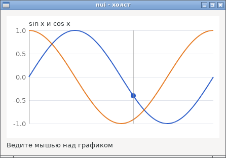
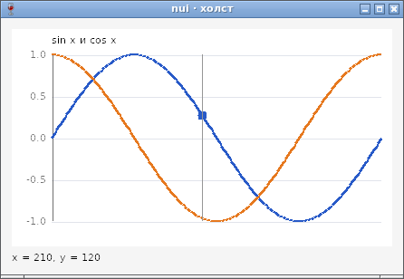
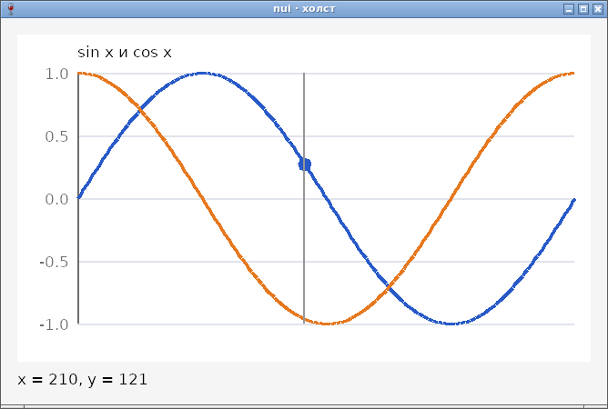

# Холст (Canvas) — отчёт

**Статус: готово (12.10.2026).** `nui.NewCanvas(func(p *nui.Painter) {…})` — своё рисование ([api.md](../api.md), §21): отрезки, прямоугольники, эллипсы (контур и заливка), текст шрифтом интерфейса, `Redraw`, мышь (`OnMouse`). Координаты — логические пиксели, сглаживание, чёткость на HiDPI. Работает на GTK и Win32, в сборках gc и TinyGo; программы без холста не растут.

## Код со снимков

График `sin x` и `cos x` с сеткой и подписями; маркер на синусоиде ходит за мышью (`OnMouse` → `Redraw`). Целиком — в описании API (§21) упрощённый вариант.

## Как устроено

| | GTK | Win32 |
|---|---|---|
| Виджет | `GtkDrawingArea` | дочернее окно класса `nuiWindow` |
| Рисование | cairo; масштаб экрана — сам cairo | GDI+ в битмап в памяти, потом один `BitBlt` (без мерцания); масштаб dpi/96 — мировым преобразованием |
| Точки | центры на половинах | `PixelOffsetModeHalf` — так же, как в cairo |
| Текст | Pango, шрифт интерфейса | GDI `DrawTextW`, шрифт окна |
| Мышь | `button-press/release`, `motion-notify`, `scroll` | `WM_*BUTTON*`, `WM_MOUSEMOVE`, `WM_MOUSEWHEEL`; `SetCapture` на время нажатия |

## Проверка

- `TestCanvas` (GTK и Wine): цвета точек рисунка на экране (`drv.PixelAt`), размер, `TextSize`, `Redraw`, `Painter` вне `draw`, мышь — нажатие с Shift, движение, отпускание, колесо с Ctrl.
- `TestCanvasSize` (GTK): размер холста без `SetMinSize` — 0×0, как в драйвере Win32.
- Демо собрано TinyGo для Linux (42 928 байт) и Windows.

Найдено по дороге:
- Программа с `math.Sin` не собиралась TinyGo с целью nui: «linker could not find symbol sin» — TinyGo отдаёт часть `math` в libm, а цель её не подключала. В `targets/linux-glibc-amd64.json` добавлена `-l:libm.so.6`; в `NEEDED` у `hello` её нет (`--as-needed`), но сам `hello` стал на 544 байта больше: `ld.lld` экспортирует `fmaximum`/`fminimum` рантайма TinyGo, раз libm определяет те же имена, и не выбрасывает их ([build.md](../build.md), §3). Работающий `math` стоит этих байтов.
- cgo TinyGo не знает тип `C.unsigned` (gc знает) — в драйвере `C.uint`.
- Win32 сообщает мышь в целых точках, GTK — дробно; в Wine первым приходит движение настоящего указателя над окном. Описано в API, тест учитывает.

## Фотоотчёт

| | |
|---|---|
|  | **Linux (GTK3), сборка TinyGo** |
|  | **Windows (Wine 8.0), 100 %**: маркер сдвинулся за настоящим указателем Xvfb |
|  | **Windows, 150 %**: тот же рисунок в 1,5 раза крупнее, подписи — шрифтом под dpi |

Сглаживание линий под Wine грубое — так рисует GDI+ самого Wine; на настоящей Windows ещё не проверено ([testing.md](../testing.md)).
