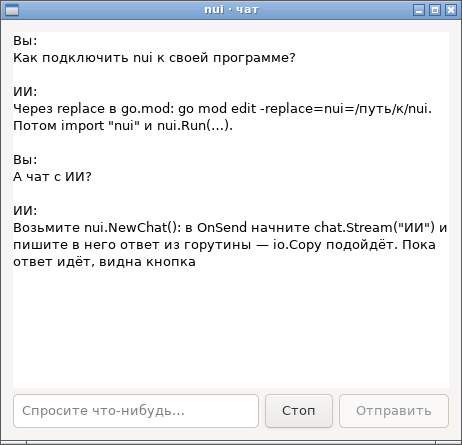
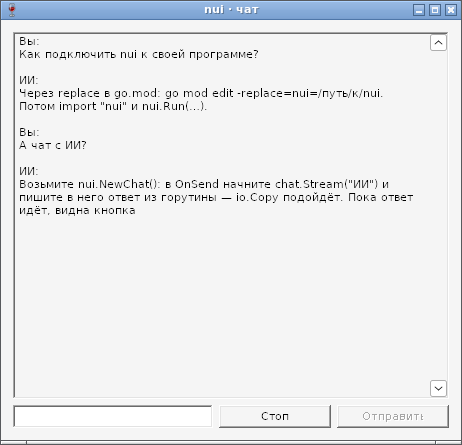
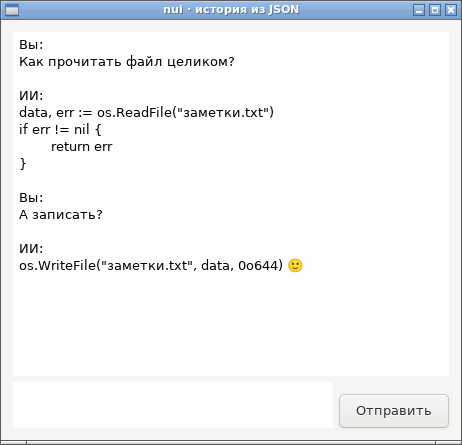
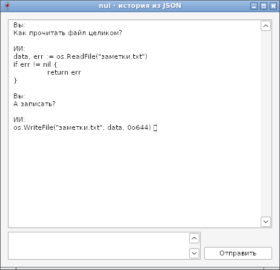

# Chat — готовый виджет чата: отчёт

**Статус: готово (09.10.2026).** `nui.NewChat()` — верхнеуровневый виджет для переписки, например с ИИ ([api.md](../api.md), §18). Пример — [examples/chat](../../examples/chat/main.go): эхо-бот, который печатает ответ по буквам.

## Как устроено

| Что | Как |
|---|---|
| Состав | лента — TextView только для чтения (перенос, прокрутка в конец), поле ввода — Entry (Enter отправляет), кнопки «Отправить» и «Стоп». Только публичные виджеты nui: драйверы не менялись, чат работает на GTK и Win32 одинаково |
| Ответ частями | `chat.Stream("ИИ")` даёт `*ChatStream` — `io.Writer`, в который можно писать из любой горутины (единственное исключение из правила потоков рядом с `Do`). Текст копится в буфере под мьютексом, в ленту его переносит таймер UI-потока каждые 40 мс — частые мелкие куски не перегружают цикл событий. Символ UTF-8, разрезанный между `Write`, ждёт продолжения и не превращается в «�» |
| Занятость | пока идёт ответ, «Отправить» недоступна, «Стоп» видна (если задан `OnStop`). «Стоп» сначала закрывает поток — дальнейший `Write` вернёт `ErrChatClosed`, и `io.Copy` остановится сам, — затем вызывает обработчик (в нём отменяют запрос) |
| Порядок | `Add`, `Stream`, `Clear` посреди ответа сначала заканчивают его: сообщения в ленте не перемешиваются |
| Горутины в библиотеке | нет (ADR-7): перенос текста — таймер цикла событий |

## Проверка

- Интеграционные тесты `TestChat*` (4 теста): отправка по Enter и кнопкой, пустой ввод, занятый чат, подписи; поток из горутины через `io.Copy` с разрезанным символом UTF-8; «Стоп»; сообщение посреди потока; `Clear`; уничтоженный чат, в который горутина ещё пишет. Проходят на GTK (в том числе `-race` и `nuidebug`) и на Win32 под Wine (`make win-test`).
- `examples/chat` в `make selftest` и `make win-selftest` — обоими тулчейнами.

## Размеры

Чат попадает в бинарник, только если программа его использует: `hello` и `form` не изменились.

| | gc | TinyGo |
|---|---|---|
| `examples/chat`, Linux | 1 346 856 | **36 848** |
| `examples/chat`, Windows | 1 509 376 | 101 376 |

Бюджет Linux — в `size-budget.txt` (замер + 10 %).

## Фотоотчёт

Ответ ещё идёт: «Стоп» видна, «Отправить» недоступна.

| | |
|---|---|
|  | **Linux (GTK3)** |
|  | **Windows (Win32, Wine 8.0)**: подсказки в пустом поле нет — программа для снимка собрана без манифеста (comctl32 v5) |

## История в JSON (10.10.2026)

`Chat.LoadJSON` показывает историю из JSON — своего вида `[{"who", "text"}]` или формата API моделей `{"messages": [{"role", "content"}]}`; `Chat.JSON` сохраняет, `Chat.Messages` отдаёт срезом. JSON разбирает `core.ParseJSON` — маленький разборщик без `encoding/json` (белый список импортов, размер TinyGo), покрытие тестами 100 %.

| | |
|---|---|
|  | **Linux**: история в формате API моделей; сообщение `system` не показано, табуляция в коде сохранена |
|  | **Windows (Wine 8.0)**: эмодзи — квадратиком, в Wine нет шрифта с эмодзи |
