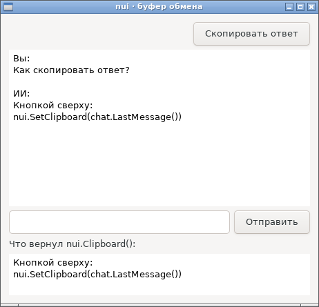
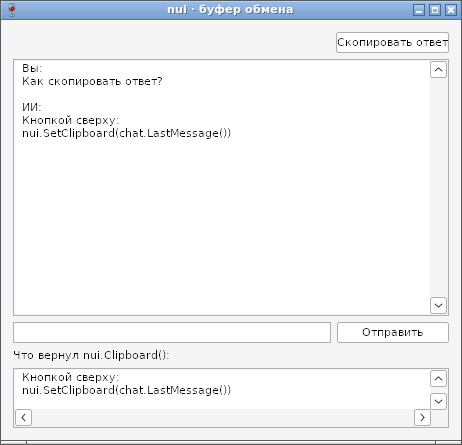

# Буфер обмена — отчёт

**Статус: готово (09.10.2026).** `nui.SetClipboard(text)` и `nui.Clipboard()` ([api.md](../api.md), §17) — текст в буфер обмена и обратно, на GTK и Win32. У чата появился `Chat.LastMessage()` — для кнопки «Скопировать ответ»; она добавлена в `examples/chat`.

## Код со снимков

```go
chat := nui.NewChat()
chat.Add("Вы", "Как скопировать ответ?")
chat.Add("ИИ", "Кнопкой сверху:\nnui.SetClipboard(chat.LastMessage())")
pasted := nui.NewTextView()
pasted.SetReadOnly(true)
pasted.SetMinSize(-1, 60)
copyBtn := nui.NewButton("Скопировать ответ", func() {
	nui.SetClipboard(chat.LastMessage())
	pasted.SetText(nui.Clipboard()) // для снимка: что вернул буфер
})
w := nui.NewWindow("nui · буфер обмена", nui.VBox(
	nui.HBox(nui.Stretch(), copyBtn),
	nui.Expand(chat),
	nui.NewLabel("Что вернул nui.Clipboard():"),
	pasted,
))
```

## Как устроено

| | GTK | Win32 |
|---|---|---|
| Положить | `gtk_clipboard_set_text` в буфер CLIPBOARD (не PRIMARY — выделение мышью) + `gtk_clipboard_set_can_store`: при выходе GTK отдаёт текст менеджеру буфера обмена | `OpenClipboard` → `EmptyClipboard` → `SetClipboardData(CF_UNICODETEXT)`; переводы строк — `\r\n` |
| Прочитать | `gtk_clipboard_wait_for_text`: вложенный цикл событий, пока владелец буфера не ответит | `GetClipboardData(CF_UNICODETEXT)`; `\r\n` → `\n` |
| Буфер занят другой программой | — | до 10 попыток `OpenClipboard` через 10 мс |
| Новые библиотеки | нет: атом `CLIPBOARD` — число 69, libgdk не нужна | нет: всё в user32 и kernel32 |

## Проверка

- `TestClipboard` (GTK и Win32 под Wine): кириллица, эмодзи, многострочный и пустой текст проходят туда и обратно без изменений. `Chat.LastMessage` проверен после `Add`, после `Stream` из двух частей и после `Clear`.
- `TestClipboardOtherProcess`: тест кладёт текст в буфер, дочерний процесс читает его через `nui.Clipboard()`. Так проверено, что текст виден другой программе, а не только хранится внутри процесса.
- Linux CI и сборки под Windows (gc и TinyGo) проходят; размер примеров в бюджете.

## Фотоотчёт

После запуска демо-программа сама нажимает «Скопировать ответ», а внизу показывает, что вернул `nui.Clipboard()`. Многострочный ответ вернулся теми же двумя строками.

| | |
|---|---|
|  | **Linux (GTK3)** |
|  | **Windows (Win32, Wine 8.0)** |

Ограничения: только текст (картинки и файлы — нет). На Linux без менеджера буфера обмена текст пропадает после выхода из программы; так устроены X11 и Wayland.
