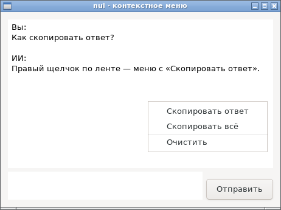
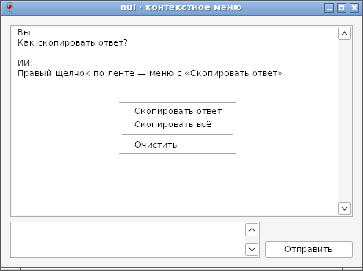

# Контекстное меню — отчёт

**Статус: готово (12.10.2026).** `SetContextMenu(items ...*MenuItem)` у любого виджета, у окна и у чата ([api.md](../api.md), §5): меню по правому щелчку, клавише «Меню» и Shift+F10. Пункты — те же, что в меню окна. Если у виджета под указателем меню нет — берётся меню контейнера выше, затем окна. Работает на GTK и Win32.

## Как устроено

| | GTK | Win32 |
|---|---|---|
| Меню | `GtkMenu`, прикреплён к виджету | `CreatePopupMenu`, узлы пунктов — у владельца |
| Правый щелчок | виджеты со своим окном событий — сами; подписи и ряды — через окно верхнего уровня, которое ищет виджет под указателем | `WM_CONTEXTMENU`: контрол или узел под точкой фона окна (`nodeAt`) |
| Поля ввода | наш обработчик идёт раньше обычного меню поля | `EDIT` подклассируется: отдаёт `WM_CONTEXTMENU` родителю |
| Список | правый щелчок выбирает строку (`get_path_at_pos` → `set_cursor`) | ListView выбирает строку сам |
| Показ | `gtk_menu_popup_at_pointer` | `TrackPopupMenu` с `TPM_RETURNCMD` → команда пункта |

Размер: метод `SetContextMenu` есть у общего `widget`, а методы `widget` TinyGo сохраняет у всех виджетов — прямой вызов построения меню держал бы в каждой программе описание пунктов меню (+968 байт у `hello`). Построение меню идёт через переменную-функцию, которую задают конструкторы пунктов (`Item`, `CheckItem`, `SubMenu`, `Sep`): программы без меню не растут.

## Проверка

`TestContextMenu` (GTK и Wine): чьё меню у точки окна (подпись в `Box` с меню, поле, подпись без меню — окно), выбор пунктов, снятие меню, повторная вставка пункта — паника, пункты уничтожаются вместе с окном.

## Фотоотчёт

| | |
|---|---|
|  | **Linux (GTK3)**: меню ленты чата вместо обычного меню текстового поля |
|  | **Windows (Wine 8.0)**: открыто настоящим `WM_CONTEXTMENU` по точке окна — найден узел ленты |

На настоящей Windows ещё не проверено.
