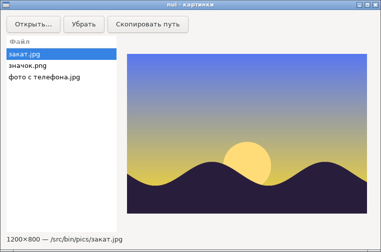
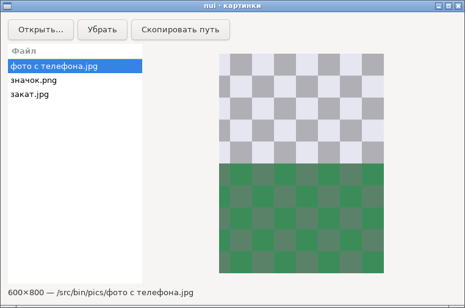
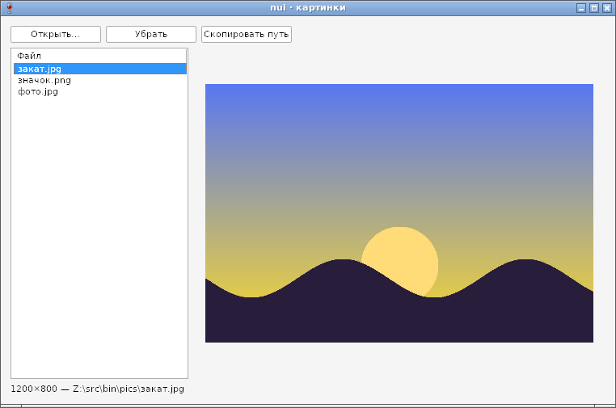
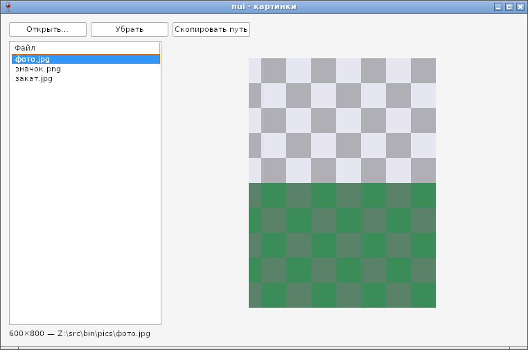

# Перетаскивание файлов, аргументы командной строки, пример viewer — отчёт

**Статус: готово (09.10.2026).**
- `Window.OnDropFiles(fn func(paths []string))` — файлы и папки, брошенные на окно из файлового менеджера ([api.md](../api.md), §5).
- `nui.Args()` — аргументы командной строки, как `os.Args`, но без потерь на Windows в сборке TinyGo (§1).
- `examples/viewer` — просмотрщик картинок: список файлов, картинка, «Открыть…» с выбором нескольких файлов, перетаскивание на окно, файлы из командной строки, клавиши Ctrl+O, Delete, Ctrl+C. Собирает вместе всё сделанное в фазе 6: `List`, `Image`, `OpenFiles`, `OnDropFiles`, `OnKey`, буфер обмена. Размер — 54 160 байт в TinyGo, 1,69 МБ в gc.

Работает на GTK и Win32, в сборках gc и TinyGo. Программы без `OnDropFiles` разбор путей не тянут — так же, как с `OnKey`.

## Как устроено

| | GTK | Win32 |
|---|---|---|
| Приёмник | `gtk_drag_dest_set(окно, GTK_DEST_DEFAULT_ALL, text/uri-list)` | `DragAcceptFiles(окно)`; бросить можно и на контролы |
| Пути | `drag-data-received` → `gtk_selection_data_get_uris` → `g_filename_from_uri` | `WM_DROPFILES` → `DragQueryFileW` → `DragFinish` |
| Программа от администратора | — | `ChangeWindowMessageFilterEx` пропускает сообщения перетаскивания (UIPI) |
| `Args` | `/proc/self/cmdline` | `CommandLineToArgvW(GetCommandLineW())` |

## Проверка

- `TestDropFiles` (GTK и Wine): пути с кириллицей, пробелом и эмодзи доходят как есть; `OnDropFiles(nil)` выключает приём. На Windows проверяется настоящий путь `WM_DROPFILES` и `DragQueryFileW` с `HDROP`, собранным так же, как его собирает оболочка; на Linux — перевод URI в пути (сам протокол XDND в тестах не участвует).
- `TestArgs` (GTK и Wine): `Args()` совпадает с `os.Args`; дочерний процесс получает русский путь с пробелами целым.
- `examples/viewer` — в `EXAMPLES`: собирается обоими тулчейнами на обеих ОС, проходит selftest и проверку размера.

Найдено по дороге: TinyGo на Windows берёт `os.Args` из `__getmainargs` — в кодировке ANSI, а считает их UTF-8. Под Wine с русской локалью имена файлов из командной строки превратились в «����», программа их не открыла (снимок сборки gc в тех же условиях — правильный). Это важно для «Открыть с помощью…» из Проводника; отсюда `nui.Args`.

## Фотоотчёт

Файлы переданы примеру в командной строке.

| | |
|---|---|
|  | **Linux (GTK3), сборка TinyGo** |
|  | **Linux**: фото 800×600 с поворотом в EXIF показано 600×800 |
|  | **Windows (Wine 8.0), сборка TinyGo**: русские имена из командной строки — через `nui.Args` |
|  | **Windows, сборка gc**: поворот по EXIF читает Go (`core.Orientation`) |

Само перетаскивание на снимке не видно; оно проверено тестами, ручная проверка с файловыми менеджерами — в [testing.md](../testing.md).
