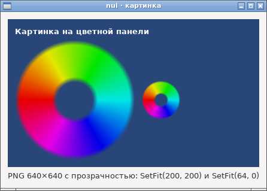
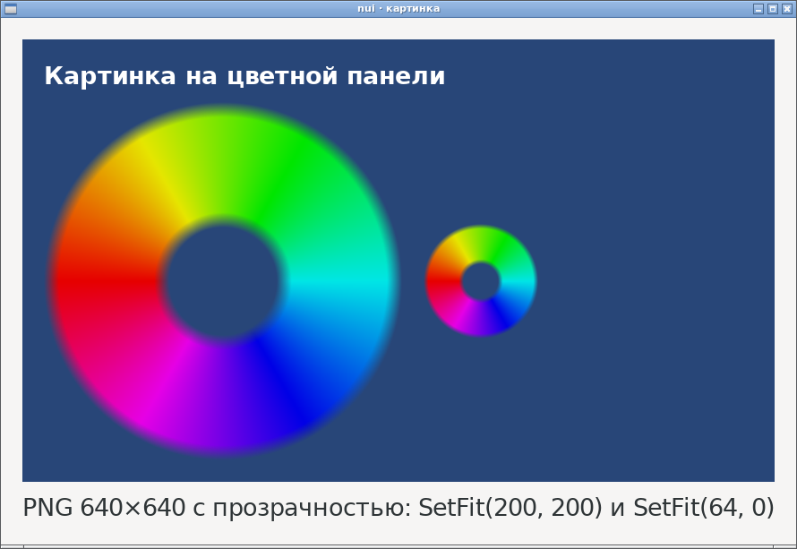
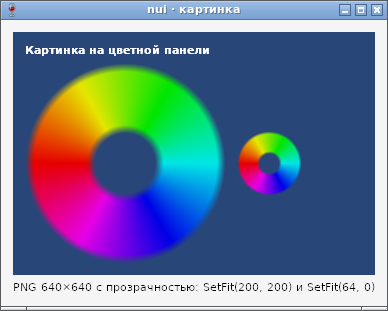
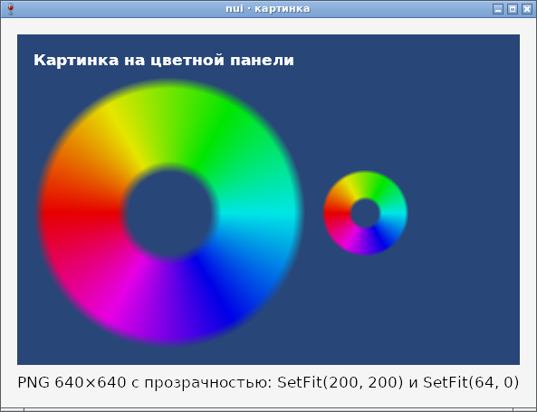
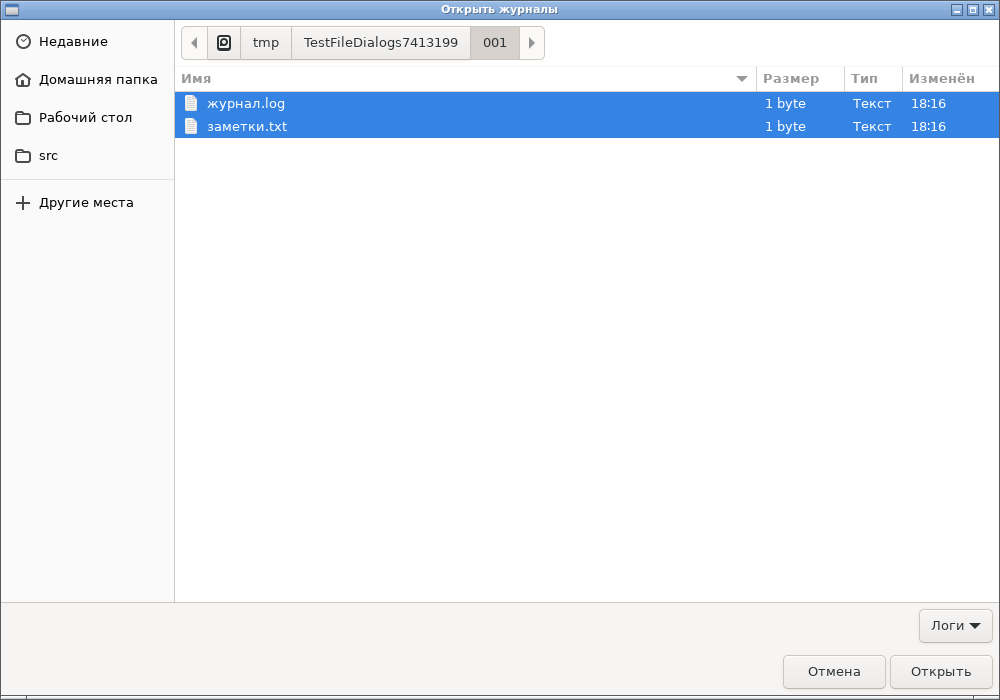

# Картинки и выбор нескольких файлов — отчёт

**Статус: готово (09.10.2026).**
- `nui.NewImage` — картинка: PNG, JPEG, GIF, BMP; `SetData`, `SetFile`, `SetFit`, `Clear`, `ImageSize` ([api.md](../api.md), §19; [ADR-20](../decisions.md)).
- `nui.OpenFiles` — выбор нескольких файлов в диалоге открытия ([api.md](../api.md), §16).

Работает на GTK и Win32, в сборках gc и TinyGo. Программы без `Image` не растут: размеры примеров не изменились, лишних библиотек в `NEEDED` нет.

## Код со снимков

```go
data := disk() // PNG 640×640: цветной круг с мягким прозрачным краем
big := nui.NewImage()
big.SetData(data)
big.SetFit(200, 200)
small := nui.NewImage()
small.SetData(data)
small.SetFit(64, 0)
title := nui.NewLabel("Картинка на цветной панели")
panel := nui.VBox(title, nui.HBox(big, small).Spacing(12)).Padding(12).Background(nui.RGB(40, 70, 120))
w := nui.NewWindow("nui · картинка", nui.VBox(panel, info))
```

## Как устроено

| | GTK | Win32 |
|---|---|---|
| Декодирование | `GdkPixbufLoader` | GDI+, `gdiplus.dll` грузится при первой картинке |
| Поворот по EXIF | `gdk_pixbuf_apply_embedded_orientation` | тег читает Go (`core.Orientation`), поворот — `GdipImageRotateFlip` |
| Масштаб экрана | cairo-поверхность w·k×h·k точек с масштабом k; при смене масштаба перерисовка в C | DIB под dpi окна; при смене dpi перерисовка вместе со шрифтами |
| Уменьшение | `gdk_pixbuf_scale_simple`, BILINEAR (при уменьшении — усреднение) | `HighQualityBicubic` + `WrapModeTileFlipXY` |
| Прозрачность | GtkImage сам | `GdiAlphaBlend` поверх фона панели |
| Несколько файлов | `set_select_multiple` + `get_filenames` | `OFN_ALLOWMULTISELECT`, разбор «каталог\0имя1\0имя2\0\0» |

Хранятся байты файла и картинка в размере показа; полноразмерная декодированная копия живёт только между загрузкой и показом.

## Проверка

- `TestImage` (GTK и Wine): PNG 120×80 занимает 120×80; `SetFit(60, 0)` → 60×40; мусор и пустые данные → `ErrImage`, прежняя картинка остаётся; JPEG 40×20 с EXIF Orientation = 6 → 20×40; `SetFile` и ошибка чтения; `Clear`; уничтоженная картинка молчит.
- `TestFileDialogs` (GTK и Wine): `OpenFiles` с двумя файлами, с одним (на Windows ответ диалога тогда другого вида) и отмена.
- `core.Fit` и `core.Orientation` — модульные тесты, покрытие `internal/core` 100 %.
- TinyGo: программа с `Image` и `OpenFiles` собирается и запускается на Linux и под Wine.

Найдено по дороге:
- В GTK 3.24 `gtk_file_chooser_select_filename` ставит курсор на файл и тем снимает прежнее выделение: программно выделить несколько файлов можно, только восстанавливая выделенные строки (помощник тестов `SimChooserAdd`).
- Wine 8.0 не отдаёт тег EXIF Orientation через GDI+, поэтому тег читает Go. Заодно поведение не зависит от версии GDI+.
- cgo TinyGo не видит полей структуры, описанной после `typedef` (`GSList`), и считает `GENERIC_READ` (0x80000000 в enum C) отрицательным. Исправлено так же, как раньше `WS_POPUP`.

## Фотоотчёт

| | |
|---|---|
|  | **Linux (GTK3), масштаб 1** |
|  | **Linux, `GDK_SCALE=2`**: картинка 400×400 точек из исходных 640×640 — чёткая |
|  | **Windows (Win32, Wine 8.0), 100 %** |
|  | **Windows, 150 %**: 300×300 точек, перерисована под dpi |
|  | **OpenFiles на GTK**: выбраны два файла |

Ограничения: анимированный GIF — первый кадр; SVG не обещан; растягивания под размер места нет (размер задаёт `SetFit`). На настоящей Windows ещё не проверено.
