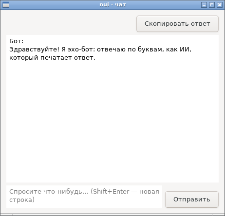
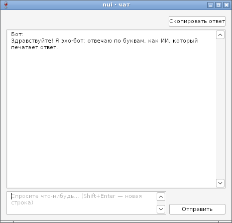
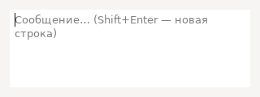

# Клавиши окна и многострочный ввод в чате — отчёт

**Статус: готово (09.10.2026).**
- `Window.OnKey(fn func(k Key, m Mod) bool)` — клавиши окна раньше виджета с фокусом ([api.md](../api.md), §5).
- `TextView.OnEnter` — Enter вызывает обработчик, Shift+Enter переводит строку; `TextView.SetPlaceholder` — серая подсказка в пустом поле (§13).
- В `Chat` поле ввода многострочное: Enter отправляет, Shift+Enter — новая строка (§18).

Работает на GTK и Win32, в сборках gc и TinyGo. Программы без `OnKey` не тянут разбор клавиш: `hello` — 23 904 байта в TinyGo (+224 байта за подписку окна на клавиши), без новых библиотек.

## Как устроено

| | GTK | Win32 |
|---|---|---|
| OnKey | `key-press-event` окна: его обработчики идут раньше, чем окно передаст клавишу виджету с фокусом | цикл сообщений до `IsDialogMessageW` отдаёт `WM_KEYDOWN`/`WM_SYSKEYDOWN` окна с меткой `nuiKeys` служебному окну |
| Буквы в другой раскладке | keyval «ы» → латинская буква той же клавиши (`gdk_keymap_get_entries_for_keycode`) | коды VK_A…VK_Z и так по положению клавиши |
| TextView.OnEnter | `key-press-event` поля; сначала метод ввода (`gtk_text_view_im_context_filter_keypress`) | метка `nuiEnter = 2`: Enter без Shift — EvEnter, Shift+Enter — `EDIT` переводит строку |
| Подсказка | обработчик `draw` после текста: `PangoLayout` полупрозрачным цветом текста | подкласс `EDIT`: после `WM_PAINT` пустого поля — `DrawTextW` серым |

## Проверка

- `TestOnKey` (GTK и Wine): Ctrl+S и F5 окно забирает, `X` отдаёт полю, Ctrl+Enter не вызывает `OnEnter` поля, клавиша через настоящий цикл сообщений (на Windows — `WM_KEYDOWN` в очередь), `OnKey(nil)` — всё полю.
- `TestOnKeyCyrillicLayout` (GTK): keyval «ы» и «ц» на клавишах S и W с Ctrl — `'S'` и `'W'`.
- `TestTextViewEnter` (GTK и Wine): Enter — обработчик без перевода строки, Shift+Enter — перевод строки, после `SetWrap` (на Windows поле пересоздаётся) Enter по-прежнему у обработчика.
- `TestChatMultiline` (GTK и Wine): Shift+Enter не отправляет, многострочное сообщение уходит целиком и в ленте остаётся многострочным.

Найдено по дороге:
- Прямой вызов разбора клавиш из обработчика событий окна держал его в каждой программе: +1,6 КБ и libgdk у `hello` без `OnKey`. Теперь разбор подключается первым вызовом `OnKey`.
- cgo TinyGo не понимает битовых полей в структурах C (`GdkEventKey.is_modifier`) — поле описано байтом, раскладка та же.
- На GTK `gtk_widget_event` отвечает «обработано», если клавишу взял кто угодно, в том числе поле: проверка «забрало ли окно» в тестах — по последствиям (что дошло до поля).

## Фотоотчёт

| | |
|---|---|
|  | **examples/chat на GTK**: многострочное поле ввода с подсказкой, «Отправить» внизу строки |
|  | **То же на Windows (Wine 8.0)**: подсказку рисует подкласс `EDIT` |
|  | **Подсказка TextView на GTK** переносится по словам |

На настоящей Windows и с методами ввода (ibus) ещё не проверено — пункты в [testing.md](../testing.md).
