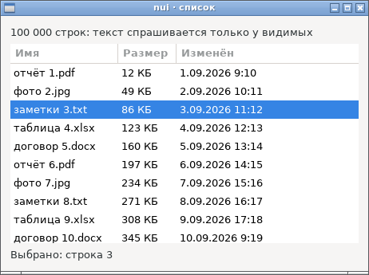
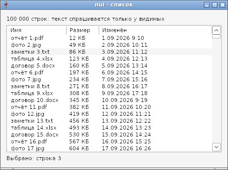

# Список и таблица (List) — отчёт

**Статус: готово (09.10.2026).** `nui.NewList` — список или таблица с колонками ([api.md](../api.md), §20). Строки не хранятся: текст ячейки спрашивается у функции `cell`, когда строка видна. Работает на GTK и Win32, в сборках gc и TinyGo. Программы без `List` не растут.

## Код со снимков

```go
l := nui.NewList("Имя", "Размер", "Изменён")
l.SetRows(100_000, func(row, col int) string { … })
status := nui.NewLabel("")
l.OnSelect(func() { status.SetText("Выбрано: строка " + strconv.Itoa(l.Selected()+1)) })
l.OnActivate(func(row int) { status.SetText("Открыть: строка " + strconv.Itoa(row+1)) })
w := nui.NewWindow("nui · список", nui.VBox(nui.NewLabel("100 000 строк: …"), nui.Expand(l), status))
w.SetSize(460, 320)
w.Show()
l.Select(2)
```

## Как устроено

| | GTK | Win32 |
|---|---|---|
| Виджет | `GtkTreeView` в прокрутке, `fixed-height-mode`: измеряется одна строка, рисуются только видимые | `SysListView32` с `LVS_OWNERDATA` |
| Данные | своя модель `GtkTreeModel` в C: строка — номер в итераторе, текст — вопрос к Go (`nuiListCell`) | `LVN_GETDISPINFOW` → функция ячеек узла |
| Новые данные | новая модель; при уничтожении старой Go забывает её функцию (`nuiListDrop`) | `LVM_SETITEMCOUNT` |
| Ширина колонок | по заголовку и первым 100 строкам (`PangoLayout`), последняя — `expand` | то же через `LVM_GETSTRINGWIDTHW`; последняя дотягивается до края при раскладке |
| Выбор | `changed` у `GtkTreeSelection` | `LVN_ITEMCHANGED`; о снятии — позже, когда ясно, выбрано ли что-то |
| Активация | `row-activated` | `LVN_ITEMACTIVATE` (двойной щелчок), Enter — метка `nuiEnter` |

Повторы «выделение поменялось» (GTK шлёт их и при движении курсора, Win32 — отдельно о снятии и о выборе) отбрасывает nui: `OnSelect` вызывается, только если строка другая.

## Проверка

- `TestList` (GTK и Wine): текст ячеек так, как его получает виджет (через `GtkTreeModel` и `LVN_GETDISPINFOW`); `Select` молчит, выбор пользователем — `OnSelect`; Enter на строке — `OnActivate`; `Update`; миллион строк — `cell` вызвана меньше 10 000 раз; пустой список; уничтоженный список.
- `TestListSize` (только GTK): 46×71 при любых данных и заголовках — эти числа берёт драйвер Win32.
- check-protos сверяет раскладки `GObject`, `GObjectClass`, `GtkTreeIter`, `GtkTreeModelIface` и структур ListView с настоящими заголовками.

Найдено по дороге:
- `GtkTreeView` в режиме SINGLE сам выделяет первую строку, как только получает фокус, — то есть при открытии окна, и `OnSelect` срабатывал без участия пользователя. После `SetRows` курсор ставится на первую строку без выделения, тогда GTK этого не делает. Так же ведёт себя ListView.
- В прокрутке 46×71 двум полосам прокрутки сразу мало места, GTK пишет критическое предупреждение. Это поведение GTK для слишком маленькой прокрутки, как у `TextView`; списку нужен `Expand` или `SetMinSize`.

## Фотоотчёт

| | |
|---|---|
|  | **Linux (GTK3)** |
|  | **Windows (Win32, Wine 8.0)**: выбранная строка серая, пока у списка нет фокуса (`LVS_SHOWSELALWAYS`), — так в Windows |

Нет пока: сортировки по заголовку, выбора нескольких строк, значков, редактирования ячеек. На настоящей Windows ещё не проверено.
