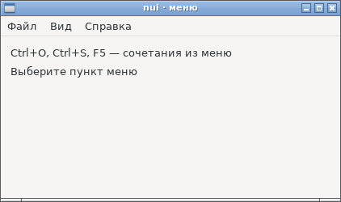
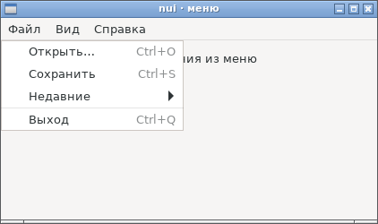
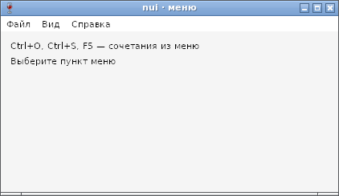
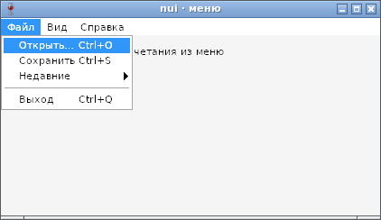

# Меню окна — отчёт

**Статус: готово (12.10.2026).** `Window.SetMenu` — строка меню окна ([api.md](../api.md), §5): `NewMenu`, `Item`, `CheckItem`, `SubMenu`, `Sep`; у пунктов `Shortcut`, `SetEnabled`, `SetChecked`, `SetText`. Работает на GTK и Win32, в сборках gc и TinyGo; программы без меню не растут.

## Код со снимков

```go
w.SetMenu(
	nui.NewMenu("Файл",
		nui.Item("Открыть…", say("Открыть")).Shortcut('O', nui.ModCtrl),
		nui.Item("Сохранить", say("Сохранить")).Shortcut('S', nui.ModCtrl),
		nui.SubMenu("Недавние", nui.Item("отчёт.txt", …), nui.Item("план.md", …)),
		nui.Sep(),
		nui.Item("Выход", nui.Quit).Shortcut('Q', nui.ModCtrl)),
	nui.NewMenu("Вид",
		nui.CheckItem("Боковая панель", …),
		nui.Item("Обновить", say("Обновить")).Shortcut(nui.KeyF1+4, 0)),
	nui.NewMenu("Справка", nui.Item("О программе", say("nui"))),
)
```

## Как устроено

| | GTK | Win32 |
|---|---|---|
| Строка меню | `GtkMenuBar` над содержимым: при первом `SetMenu` окно перестраивается в ряд [меню, содержимое с отступом окна] | `HMENU` в неклиентской области |
| Пункты | `GtkMenuItem`, `GtkCheckMenuItem`, разделитель; подменю — `GtkMenu` | `AppendMenuW`; команды от 1000; подменю — `CreatePopupMenu` |
| Выбор | `activate` | `WM_COMMAND` окну; флажок переключает драйвер |
| Сочетания | подпись — `GtkAccelLabel`; срабатывают в nui | подпись — после табуляции («Ctrl+O»); срабатывают в nui |
| Размер окна | окно растёт на высоту строки меню | рамка считается с меню (`AdjustWindowRectExForDpi`) |

Сочетания срабатывают в nui тем же разбором клавиш, что `OnKey`: раньше `OnKey`, по положению клавиши, одинаково на обеих ОС.

## Проверка

`TestMenu` (GTK и Wine): выбор пунктов и подменю, сочетание раньше `OnKey`, выключенный пункт, флажок, подпись с сочетанием, `SetText`, размер окна под меню, замена и удаление меню, повторная вставка пункта — паника.

Найдено по дороге:
- GTK: размер, заданный до `SetMenu`, съедала строка меню (окно 400×250 давало 400×225 под меню). Теперь окно меняется на высоту строки меню — область под меню та же, что на Windows.
- Win32: при замене меню прежняя строка снималась с окна раньше, чем запоминался размер клиентской области, — после удаления меню окно оставалось выше. Размер запоминается до снятия.
- Размер программ без меню: поле со срезом пунктов меню в `Window` тянуло в каждую сборку TinyGo описание типа `MenuItem` (+1,3 КБ у `hello`), а учёт строки меню в `SetSize` — лишние вызовы GTK. Теперь окно обращается к меню через переменные-функции, которые задаёт `SetMenu`, внутренний контейнер — `GtkEventBox` (те же вызовы, что у окна), высота строки — в данных окна. Итог: `hello` +168 байт к прежнему, `form` +96.

## Фотоотчёт

| | |
|---|---|
|  | **Linux (GTK3)** |
|  | **Linux**: меню «Файл» — сочетания справа, подменю, разделитель |
|  | **Windows (Wine 8.0)** |
|  | **Windows**: сочетания после табуляции выровнены Windows |

На настоящей Windows ещё не проверено.
