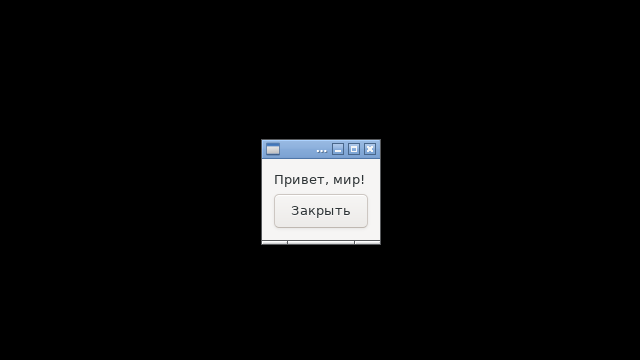
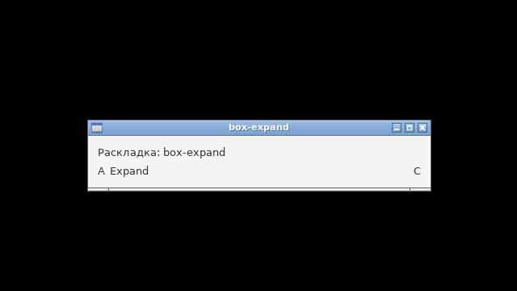
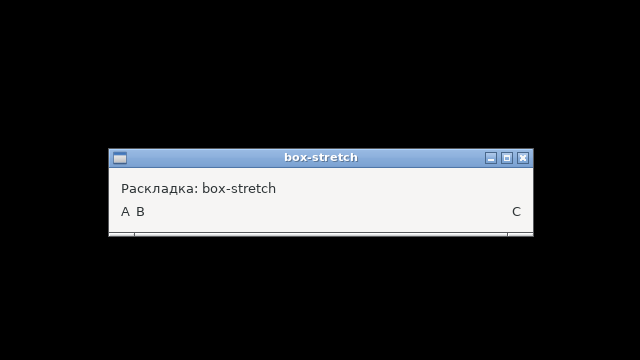
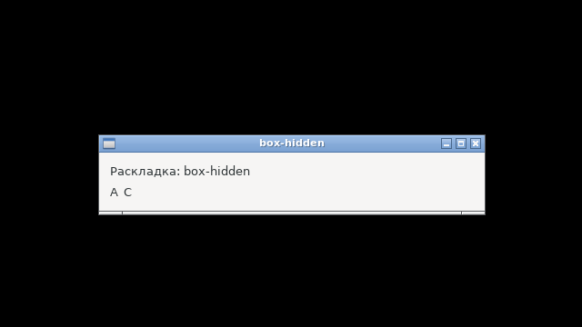

# Фаза 1 — скелет: отчёт

**Статус: готово (08.10.2026).** Ядро, драйвер GTK3, базовые виджеты, раскладка Box, таймеры, `Watch`, `Do`, автовыход, `examples/hello`, Makefile и инструменты. Всё проверено в чистом Debian 12 (`make docker-ci`) и на хосте (`make check`).

## Что сделано

| Часть | Файлы | Что внутри |
|---|---|---|
| Ядро | [internal/core](../../internal/core/) | реестр, `UD`/`Decode`, `Dispatch`, очередь `Do`, `FixUTF8`/`Itoa`/`Dir`, проверки `nuidebug` |
| Драйвер GTK3 | [internal/drv](../../internal/drv/) | свои прототипы, 4 трамплина, нормализация виджетов, окно, метка, кнопка, Box, таймеры, `Watch`, `Wake`; помощники тестов `Sim*`, `Allocation` |
| Публичный API | [`*.go`](../../) в корне | `Run`, `Quit`, `SetAppID`, `ErrNoDisplay`, `Do`, `After`, `Every`, `Watch`; `Window` (`SetTitle`, `Title`, `SetChild`, `Show`, `Hide`, `Close`, `OnClose`); `Label`, `Button`, `VBox`/`HBox`/`Expand`/`Stretch`; общие методы виджетов |
| Пример | [examples/hello](../../examples/hello/main.go) | 13 строк, режим `-tags selftest` |
| Цель TinyGo | [targets/linux-glibc-amd64.json](../../targets/linux-glibc-amd64.json) | ADR-17 + `--as-needed` |
| Сборка и проверки | [Makefile](../../Makefile), [tools/](../../tools/) | `check-protos`, `depcheck`, `sizecheck`, `abicheck`, `docker-run`, образ `bookworm.Dockerfile`, `rootshot` |

## Критерии готовности (roadmap.md)

| Критерий | Итог |
|---|---|
| `make ci` зелёный, включая TinyGo | ✓ `make check` (vet, deps, check-protos) + `make docker-ci` (deps, тесты, race, selftest, size, abi) |
| `examples/hello` ≤ 15 строк, работает под gc и TinyGo | ✓ 13 строк; selftest gc и TinyGo — код 0 |
| Покрытие `internal/core` ≥ 90 % | ✓ **100 %** (и в обычной, и в отладочной сборке) |
| Интеграционные тесты | ✓ 17 тестов: Set не вызывает On, Sim вызывает, замена и снятие обработчика; методы уничтоженных объектов ничего не делают; `SetChild` уничтожает старого ребёнка; правила вставки (паники); `OnClose`; таймеры (`Every` + `Stop` изнутри); `Watch` на pipe (`IORead`, `IOHup`, `Stop`); `Do` асинхронен, порядок 100 горутин × 100; раскладка Box; автовыход (последнее окно, скрытое окно не держит, `Hide` не выходит, `Quit` в setup); нет дисплея → `ErrNoDisplay`. Проходят с `G_DEBUG=fatal-criticals`, с `-tags nuidebug` и под `-race` |
| Размеры в бюджете | ✓ см. ниже |

## Размер `examples/hello`

| Сборка | Байт |
|---|---|
| TinyGo, `-scheduler=none`, после `strip` | **23 680** |
| gc, `-trimpath -ldflags="-s -w"` | 1 301 352 |

TinyGo меньше в **55 раз**. Бюджеты в [size-budget.txt](../../size-budget.txt) — замер + 10 %. Оба бинарника требуют glibc не новее 2.34. Релизный TinyGo-`hello` подключает только `libc.so.6`, `libgtk-3.so.0` и `libgobject-2.0.so.0`: `libglib` выпала по `--as-needed`, потому что без selftest таймеры не используются.

## Решения по ходу

- **Обработчики событий — на неэкспортируемых типах** (`type buttonEv Button` с методом `Event`): реестр хранит `(*buttonEv)(b)`. Метод `Event` не попадает в публичный API, лишних аллокаций нет.
- **`Window` не встраивает `widget`**: у окна свой набор методов, и в контейнер его не вставить — `Window` не реализует `Widget`.
- **Окно-якорь в `TestMain`.** По ADR-15 закрытие последнего видимого окна завершает `Run`, поэтому тесты держат видимое окно до конца прогона; сценарии автовыхода идут в дочернем процессе (`NUI_HELPER`).
- **`core.MarkUIThread(f)`** принимает функцию проверки потока: ядро без cgo не может само вызвать `drv.IsMainThread`.
- **Контейнер для проверок** — `tools/docker-run.sh`: чистый Debian 12, запуск от текущего пользователя, кэши сборки между запусками.

## Фотоотчёт

Снимки делает `make shots` в контейнере: Xvfb, openbox, `LANG=ru_RU.UTF-8`, инструмент `rootshot`.

| | |
|---|---|
|  | **`examples/hello`, сборка TinyGo (23 680 байт).** Метка и кнопка «Закрыть» (вызывает `nui.Quit`). Сборка gc выглядит так же, пиксель в пиксель |
|  | **`HBox(A, Expand(B), C)`, ширина 400.** B забирает всё свободное место, C у правого края |
|  | **`HBox(A, B, Stretch(), C)`.** Вставка прижимает C к правому краю |
|  | **`HBox(A, скрытый, C)`.** Скрытый виджет не занимает места, C сразу за A |

Положения виджетов в этих окнах сверяет `TestBoxLayout` через `drv.Allocation`: отступ окна 12, промежуток 6, ряд 400.

## Дальше

Фаза 2: виджеты MVP (Entry, Check, Combo, Slider, Progress, TextView, Separator, Frame, Scroll, Grid), остальное у Label и Window, `examples/form`.
