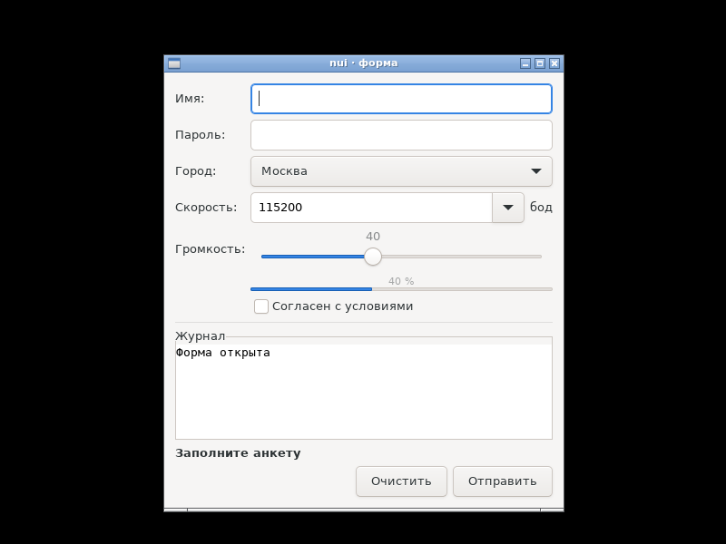
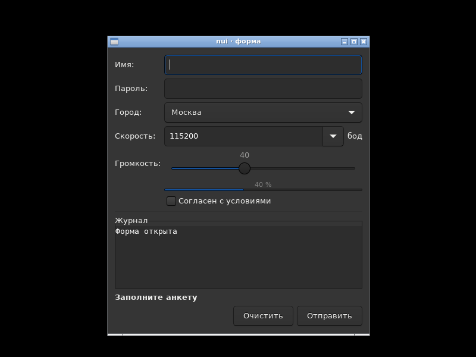
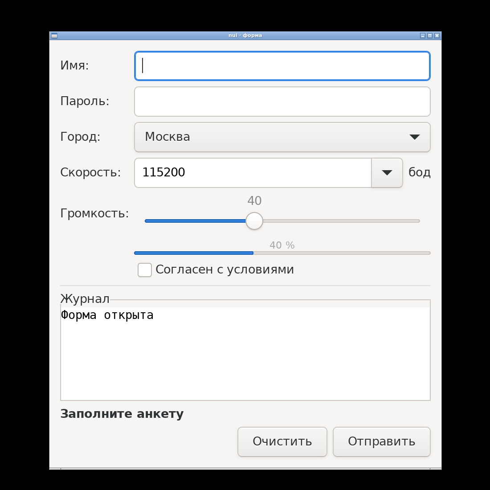
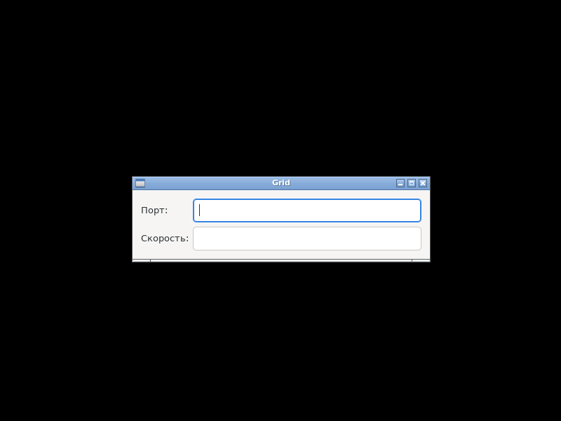
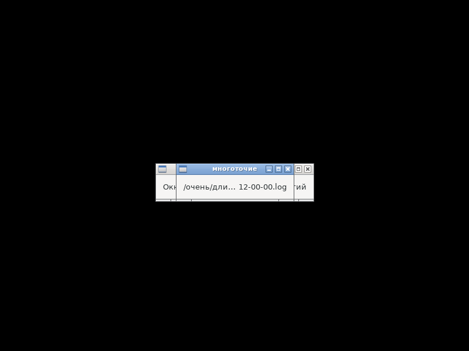
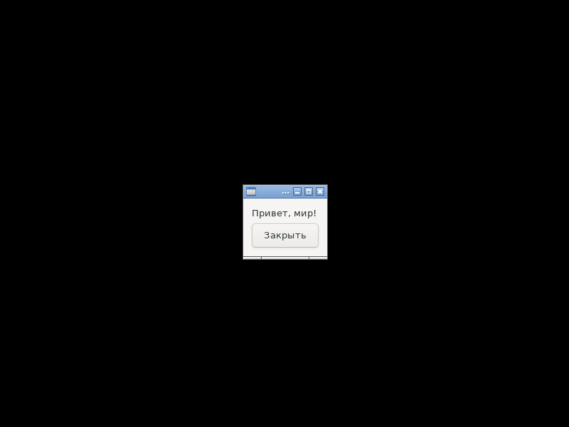

# Фаза 2 — виджеты MVP: отчёт

**Статус: готово (08.10.2026).** Все виджеты MVP из [api.md](../api.md), §4–§15, пример [`examples/form`](../../examples/form/main.go) со всеми ними на одной форме. Проверено в чистом Debian 12 (`make docker-ci`) и на хосте (`make check`).

## Что сделано

| Виджет | Публичный API | Особенности реализации |
|---|---|---|
| Label | `SetEllipsis`, `SetWrap`, `SetSelectable`, `SetTextAlign`, `SetBold`, `SetColor`; `Color`, `RGB`, `NoColor`, `Ellipsis*` | жирность и цвет — атрибуты Pango; состояние хранится в самой метке (`g_object_set_data`, число), у `nui.Label` нет лишних полей |
| Window | `SetSize`, `SetResizable`, `SetPadding`, `SetDefault`, `SetIconName` | последний `SetSize` хранится в default size окна; `SetResizable` заново применяет его в нужном смысле |
| Entry | `SetText`/`Text`, `SetPlaceholder`, `SetPassword`, `SetReadOnly`, `SetWidthChars`, `OnChange`, `OnEnter` | `OnEnter` выключает `activates_default`, `OnEnter(nil)` возвращает |
| Check | `SetChecked`/`Checked`, `SetText`/`Text`, `OnChange` | |
| Combo | `NewCombo`, `NewComboEntry`, `Add`, `Clear`, `Len`, `Item`, `Selected`/`SetSelected`, `Text`/`SetText`, `OnChange` | копия элементов на стороне Go; у ComboEntry Enter в поле нажимает кнопку по умолчанию |
| Slider | `SetValue`/`Value`, `OnChange` | `min ≥ max` — паника |
| Progress | `SetValue`/`Value`, `Pulse`, `SetText` | |
| TextView | `SetText`/`Text`, `Append`, `Clear`, `SetReadOnly`, `SetMonospace`, `SetWrap`, `SetAutoScroll`, `SetMaxLines`, `OnChange` | `nui_text_append`: подсчёт строк без «лишней» после `\n`, автопрокрутка через свою метку — выделение не сбивается |
| Separator, Frame, Scroll | `NewSeparator`, `NewVSeparator`, `NewFrame` (`SetTitle`, `SetChild`), `NewScroll` | |
| Grid | `NewGrid`, `Add`, `AddSpan`, `ExpandCol`, `ExpandRow`, `Spacing`, `Padding` | `ExpandCol`/`ExpandRow` до и после `Add`; пересечение ячеек — паника в `nuidebug` |

Помощники тестов: `SimType`, `SimComboType`, `SimEnter`, `SimToggle`, `SimSelect`, `SimSlide`, `SimEdit`.

## Критерии готовности (roadmap.md)

| Критерий | Итог |
|---|---|
| Каждая строка api.md, §4–§15 покрыта интеграционным тестом: Set/Get с кириллицей, правило Set ≠ On, уничтожение | ✓ 31 интеграционный тест (14 новых): строки с кириллицей, эмодзи, пустые, с `\x00` и битым UTF-8 через каждый текстовый Set/Get; программные `Set*`, `Add`, `Clear`, `Append` не вызывают `On*`, `Sim*` вызывают; геттеры уничтоженных виджетов — нулевые значения. Проходят с `G_DEBUG=fatal-criticals`, `nuidebug` и `-race` |
| `check-protos` проходит | ✓ ≈ 130 прототипов и констант, включая размер `NuiTextIter` ≥ `GtkTextIter` |
| Ручной чек-лист раскладки на `examples/form` | частично автоматизирован — снимки ниже: форма, тёмная тема, масштаб 2×, многоточие, Grid. Остаются ручными: KDE/XFCE, дробный масштаб, IME, Orca |
| DCE: `examples/hello` не вырос | ✓ TinyGo — **ни на байт** (23 680). gc — содержимое +≈360 байт, файл +4 096 из-за выравнивания по странице (≤ 1 КБ по правилу) |

## Размеры

| Пример | TinyGo, после `strip` | gc |
|---|---|---|
| `hello` | 23 680 | 1 305 448 |
| `form` (все виджеты MVP) | **41 808** | 1 396 424 |

Оценка в size.md для `form` была ≤ 160 КБ — получилось почти вчетверо меньше. Бюджеты в [size-budget.txt](../../size-budget.txt) — замер + 10 %.

## Находки

- **Проверка DCE поймала рост `hello` на 288 байт** — не из-за новых виджетов (их код полностью выбрасывается), а из-за метаданных типов: у `Label` и `Window` появились поля. Состояние перенесено в сам GTK — рост ноль.
- **GNU ld + `--as-needed` оставляет `libpango` в `NEEDED` gc-сборки `hello`**, хотя ни одного символа Pango в бинарнике нет: решение «нужна ли библиотека» GNU ld принимает до того, как `--gc-sections` выбросит неиспользуемые обёртки. На работу не влияет — Pango всё равно грузит сам GTK. У TinyGo этого нет: LTO выбрасывает код до линковки.
- **Кнопка по умолчанию нажимается с задержкой ~250 мс**: `GtkButton` на `activate` показывает нажатие и шлёт `clicked` по таймеру. Тест ждёт нажатия, а не проверяет его сразу.
- **`t.Fatal` нельзя звать из UI-потока** (внутри `ui()`): он завершает горутину, в которой вызван, — а это главный поток с циклом GTK. В тестах внутри `ui()` — только `t.Error`.

## Фотоотчёт

`make shots` в контейнере: Xvfb, openbox, `LANG=ru_RU.UTF-8`, `rootshot`.

| | |
|---|---|
|  | **`examples/form`, сборка TinyGo (41 808 байт).** Grid «подпись: поле» с растягиваемой колонкой; Entry, пароль, Combo, ComboEntry с подписью «бод», Slider, Progress «40 %», Check; журнал — TextView моноширинным шрифтом в рамке; жирная строка состояния; кнопки справа (`Stretch`), «Отправить» — по умолчанию. Сборка gc — пиксель в пиксель такая же |
|  | **Тёмная тема** (`GTK_THEME=Adwaita:dark`): nui своих цветов не задаёт, всё берётся из темы |
|  | **Масштаб 2×** (`GDK_SCALE=2`): размеры в логических пикселях, GTK удваивает всё сам; раскладка цела |
|  | **Grid: `ExpandCol(1)`** — колонка полей забирает всё свободное место, подписи выровнены по ширине самой длинной (`TestGridLayout` сверяет координаты) |
|  | **`EllipsisMiddle`** у длинного пути в окне шириной 200: «/очень/дли… 12-00-00.log». Без многоточия метка не даёт окну стать уже текста (`TestLabelEllipsisWidth`) |
|  | **`hello`** — не изменился |

## Дальше

Фаза 3: диалоги и оболочка — `Message`, `Alert`, `Ask`, `OpenFile`, `SaveFile`, `ChooseFolder`, `OpenURI`, `ShowInFolder`.
