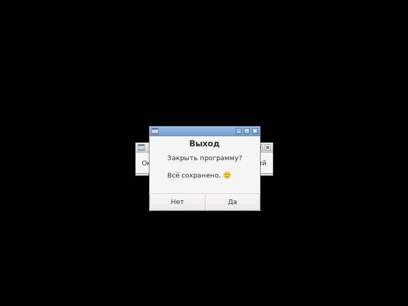
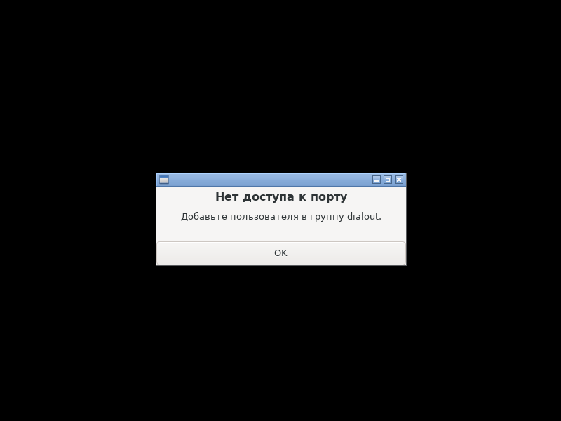
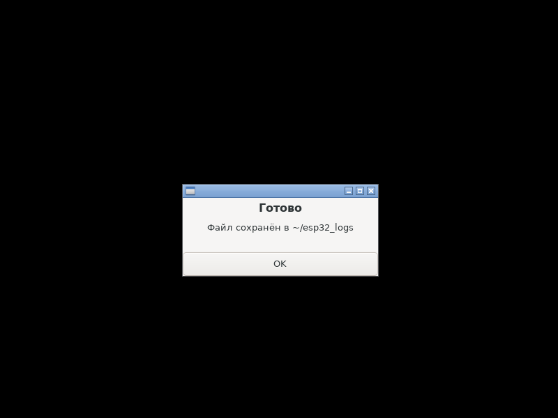
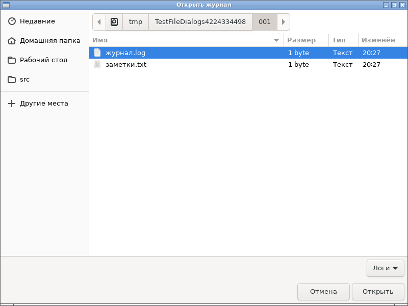
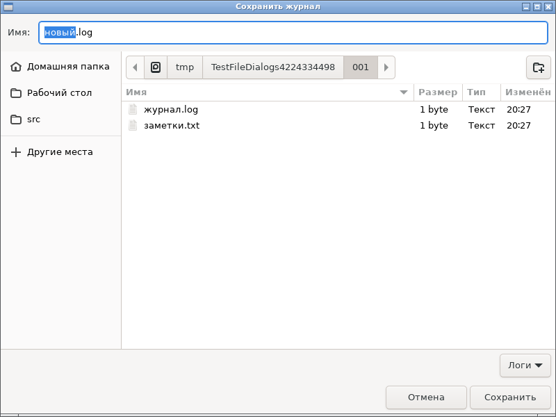
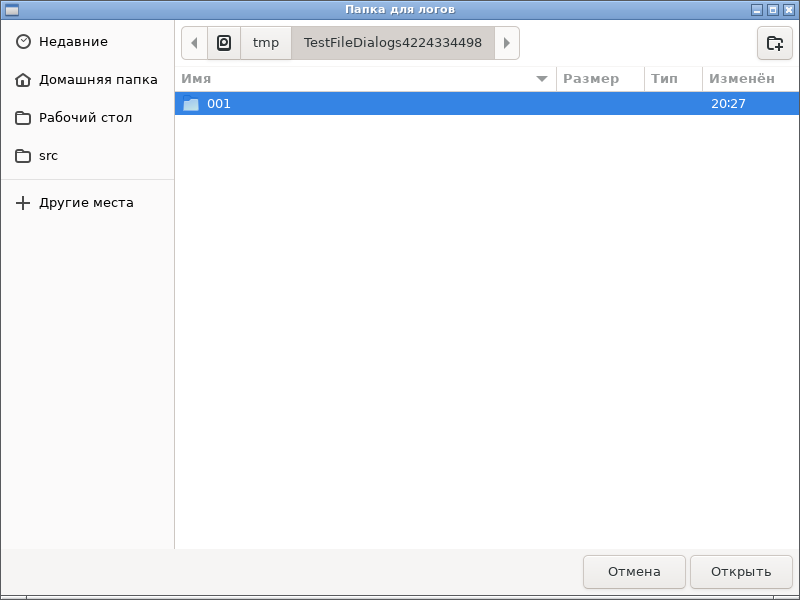

# Фаза 3 — диалоги и оболочка: отчёт

**Статус: готово (08.10.2026).** `Message`, `Alert`, `Ask`, `OpenFile`, `SaveFile`, `ChooseFolder`, `OpenURI`, `ShowInFolder` по [api.md](../api.md), §16–§17. Проверено в чистом Debian 12 (`make docker-ci`) и на хосте (`make check`).

## Что сделано

| Функция | Как устроено |
|---|---|
| `Message`, `Alert`, `Ask` | `nui_message`: `gtk_message_dialog_new` (MODAL, DESTROY_WITH_PARENT) + вторичный текст + `gtk_dialog_run`. Своя ссылка на диалог: если родитель уничтожится, пока диалог открыт, `Ask` вернёт `false` без use-after-free |
| `OpenFile`, `SaveFile`, `ChooseFolder` | `GtkFileChooserNative` (в песочнице — портал), модальный; фильтры; у Save — подтверждение перезаписи и предлагаемое имя. Путь возвращается в кодировке ФС, без замены байтов |
| `OpenURI` | `gtk_show_uri_on_window` |
| `ShowInFolder` | `g_filename_to_uri` для файла и каталога → `nui_show_items`: **асинхронный** вызов D-Bus `org.freedesktop.FileManager1.ShowItems`, интерфейс не ждёт. Ошибка (службы нет) → C-колбэк сам открывает папку. Нет сессии D-Bus → папка открывается сразу |

## Найдено и исправлено в ядре: очередь `Do` и модальные диалоги

Тест диалогов повис, и стек показал **ошибку в `core.Drain`**. Если в одну пачку `Do` попали две функции и первая открыла модальный диалог, вторая ждала его закрытия: флаг «idle уже запланирован» был снят, но новый idle-источник никто не заводил. Контракт же обещает, что `Do` работает, пока открыт диалог (api.md, §0).

Исправление: `Drain` берёт функции из очереди **по одной**. Если перед вызовом очередной функции в очереди есть ещё, цикл будится заранее, и остаток выполнит вложенный `Drain` внутри диалога. Каждую функцию забирает ровно один `Drain`, поэтому порядок сохраняется. Новый юнит-тест `TestDrainNestedLoop`, покрытие ядра по-прежнему 100 %.

## Критерии готовности (roadmap.md)

| Критерий | Итог |
|---|---|
| Ручной чек-лист диалогов в GNOME (Wayland) и KDE | частично автоматизирован: снимки ниже (русские подписи кнопок, фильтры, предлагаемое имя), ответы «Да», «Нет», Esc и OK — в тестах. Остаются ручными: GNOME/KDE, портал (`GTK_USE_PORTAL=1`), клавиатура |
| `ShowInFolder` выделяет файл в Nautilus и Dolphin, а без `FileManager1` открывает папку | без `FileManager1` — ✓ автоматически, двумя путями: без сессии D-Bus и с настоящей сессией (`dbus-daemon`), где служба не отвечает. Выделение в Nautilus/Dolphin — вручную |
| Таймеры и `Do` работают, пока открыт модальный диалог | ✓ `Every` тикает, пока открыт `Message`; ответы в диалогах тесты дают через `Do` |

Интеграционных тестов теперь 35. Новые: `TestMessageDialogs`, `TestDialogParentDestroyed`, `TestFileDialogs` (открыть, отмена, сохранить, папка), `TestOpenURIAndShowInFolder` (дочерний процесс с подставной программой по умолчанию, которая записывает, что её попросили открыть).

## Размеры

DCE работает: `hello` и `form` диалогов не используют, и в TinyGo не выросли ни на байт — 23 680 и 41 808. В gc `form` +4 096 байт: выравнивание по странице плюс лишняя запись `NEEDED libgio` (та же особенность GNU ld и `--as-needed`, что с Pango в фазе 2).

## Находки

- **`dbus-daemon` падает с «Memory allocation failure», если uid процесса нет в `/etc/passwd`.** `tools/docker-run.sh` теперь подкладывает в контейнер `passwd` и `group` с текущим uid.
- **`gtk_dialog_get_type` и другие `*_get_type` объявлены с `G_GNUC_CONST`**, а атрибут `const` у GCC — часть типа функции. `check-protos` поймал расхождение сразу; для таких функций — макрос `NUI_FN_CONST`, который сверяет тип результата.
- **`GtkFileChooserNative` без портала показывает обычный `GtkFileChooserDialog`** — тесты находят его среди окон верхнего уровня и «отвечают» за пользователя. Каталог в нём загружается асинхронно, поэтому между выбором пути и «Открыть» тест ждёт.

## Фотоотчёт

`make shots` в контейнере: Xvfb, openbox, `LANG=ru_RU.UTF-8`, `rootshot`.

| | |
|---|---|
|  | **`Ask(w, "Выход", "Закрыть программу?\n\nВсё сохранено. 🙂")`** — крупный заголовок, пояснение с переводом строки и эмодзи, кнопки «Нет»/«Да» на языке системы |
|  | **`Alert(nil, "Нет доступа к порту", …)`** — без родителя, кнопка OK |
|  | **`Message(w, "Готово", …)`**; пока он открыт, `Every` продолжает тикать (`TestMessageDialogs`) |
|  | **`OpenFile(w, "Открыть журнал", Filter{"Логи", …})`** — выбран «журнал.log», фильтр «Логи» |
|  | **`SaveFile(w, "Сохранить журнал", "новый.log", …)`** — предложенное имя, часть до расширения выделена для правки |
|  | **`ChooseFolder(w, "Папка для логов")`** |

## Дальше

Фаза 4 — приёмочное приложение из acceptance.md. Не начинаю: в нём аппаратная часть, а сейчас работа идёт только над самим фреймворком. Следующей беру фазу 5 (Windows): сначала то, что не требует Windows, — движок раскладки `internal/layout` и golden-тесты против GTK.
