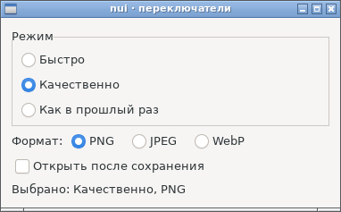
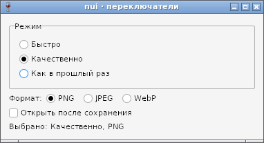

# Переключатель (Radio) — отчёт

**Статус: готово (12.10.2026).** `nui.NewRadio(items...)` — несколько вариантов, выбран ровно один ([api.md](../api.md), §9): `Add`, `Len`, `Item`, `Selected`, `SetSelected`, `SetHorizontal`, `Focus`, `OnChange`. Работает на GTK и Win32.

## Как устроено

| | GTK | Win32 |
|---|---|---|
| Виджет | `GtkBox` с `GtkRadioButton` одной группы | узел-ряд, как Box; варианты — `BUTTON` `BS_RADIOBUTTON` |
| Выбор | группа GTK; `OnChange` — `toggled` от включившейся кнопки | ведёт nui: у `BS_AUTORADIOBUTTON` в группу попали бы соседние чужие контролы (группа — по Z-порядку до `WS_GROUP`) |
| Стрелки | сама `GtkRadioButton` | цикл nui до `IsDialogMessageW` |
| Tab | на выбранный вариант | `WS_TABSTOP` только у выбранного |

Поведение стрелок снято с GTK пробой: стрелка выбирает соседний вариант и переводит на него фокус; у края группы ничего не происходит, по кругу выбор не идёт и из группы не уходит. Win32 делает так же; сам `IsDialogMessageW` увёл бы фокус за край группы.

Попутно найдено и исправлено расхождение драйверов: на Win32 показанное окно не росло, когда минимальный размер содержимого увеличивался (переключатель перевели в ряд, добавили виджеты). GTK такое окно увеличивает, и layout.md требует того же. Теперь `relayout` на Win32 увеличивает окно до минимума содержимого и оставляет его на прежнем месте; развёрнутое и полноэкранное окно не растёт.

Для снимков в образ CI добавлен загрузчик SVG для gdk-pixbuf (`librsvg2-common`). Без него Adwaita не рисовала точку выбранного варианта и галочку флажка; на настоящем рабочем столе он есть всегда.

Размер программ без переключателя:
- **Linux.** Не меняется: код переключателя в них не попадает.
- **Windows.** Код переключателя общий код узлов вызывает через хуки (`radioHooks`). TinyGo `hello` +0,5 КБ, `form` +1 КБ — это рост окна под содержимое, разбор стрелок в цикле и ветки в общем коде.

## Проверка

`TestRadio` (GTK и Wine, обычная и отладочная сборка):
- выбран первый вариант;
- `SetSelected` без `OnChange`, вне диапазона — ничего;
- щелчок по варианту вызывает `OnChange`, по уже выбранному — нет;
- стрелки вверх и вниз, в том числе у краёв группы;
- `Add` не меняет выбора;
- пустой переключатель;
- в ряд — ниже и шире, окно выросло под ряд.

## Фотоотчёт

| | |
|---|---|
|  | **Linux (GTK3)**: «Режим» — в столбик в рамке, «Формат» — в ряд, `SetSelected(1)` до показа |
|  | **Windows (Wine 8.0)**; синий кружок у «Как в прошлый раз» — подсветка под указателем мыши |

На настоящей Windows ещё не проверено.
