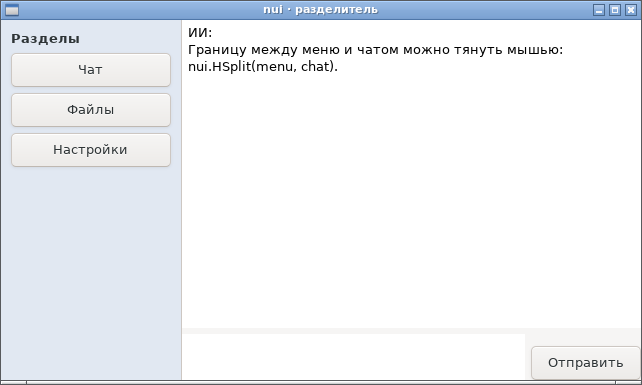
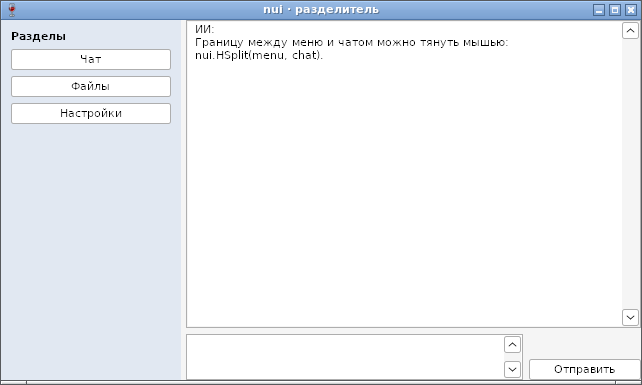

# Разделитель панелей (Split) — отчёт

**Статус: готово (12.10.2026).** `nui.HSplit(first, second)` и `nui.VSplit` — две панели с границей, которую пользователь двигает мышью ([api.md](../api.md), §15); `SetPosition`, `Position`. Работает на GTK и Win32.

## Как устроено

| | GTK | Win32 |
|---|---|---|
| Виджет | `GtkPaned`: первая панель `resize=FALSE`, вторая `resize=TRUE`, обе `shrink=FALSE` | своего нет: узел-ряд с промежутком-полосой, HWND — полоса |
| Положение | GtkPaned: без `set_position` — естественный размер первой панели | то же правило в `placeSplit`, панели раскладываются заново |
| Граница | линия в 1 точку, полоса захвата шире | полоса 5 точек с курсором «↔», как в Проводнике |
| Перетаскивание | GtkPaned | `SetCapture`, курсор на экране, `relayout` на каждое движение |

Правило положения сначала снято с GTK тестом-замером: 376 = 96 + 1 + 279 (окно 400 без отступов: первая панель — естественные 96, граница 1, вторая — остальное); `SetPosition(10)` даёт 96 (минимум панели); при растягивании окна первая панель держит размер.

## Проверка

`TestSplit` (GTK и Wine): начальное положение, `SetPosition`, упор в минимум, растягивание окна, перетаскивание (на Windows — настоящее: нажатие, `SetCursorPos`, движение, отпускание), скрытая панель, `VSplit`.

## Фотоотчёт

| | |
|---|---|
|  | **Linux (GTK3)**: боковое меню (цветная панель) и чат, `SetPosition(180)` |
|  | **Windows (Wine 8.0)** |

На настоящей Windows ещё не проверено.
