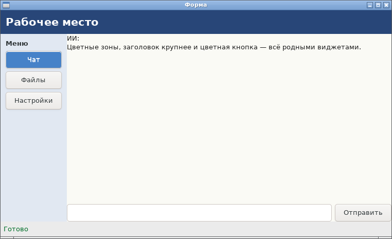
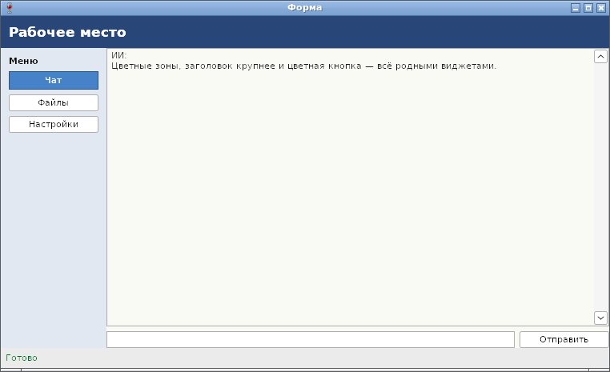

# Оформление: цвет, фон, размер шрифта — отчёт

**Статус: готово (09.10.2026).** Набор оформления (ADR-19, [api.md](../api.md), §4): фон у окна, Box и Grid, цвет текста и фон у подписей, кнопок, полей, TextView и чата, размер шрифта подписей. Работает на GTK и Win32 одинаково.

## Код со снимков

```go
err := nui.Run(func() {
	title := nui.NewLabel("Рабочее место")
	title.SetFontScale(1.6)
	title.SetBold(true)
	title.SetColor(nui.RGB(255, 255, 255))
	header := nui.HBox(title).Padding(10).Background(nui.RGB(40, 70, 120))

	menuTitle := nui.NewLabel("Меню")
	menuTitle.SetBold(true)
	b1 := nui.NewButton("Чат", nil)
	b1.SetBackground(nui.RGB(70, 130, 200))
	b1.SetColor(nui.RGB(255, 255, 255))
	menu := nui.VBox(menuTitle, b1, nui.NewButton("Файлы", nil), nui.NewButton("Настройки", nil)).
		Padding(10).Background(nui.RGB(225, 232, 242))

	chat := nui.NewChat()
	chat.SetBackground(nui.RGB(250, 250, 245))
	chat.SetColor(nui.RGB(30, 30, 30))
	chat.Add("ИИ", "Цветные зоны, заголовок крупнее и цветная кнопка — всё родными виджетами.")

	status := nui.NewLabel("Готово")
	status.SetColor(nui.RGB(0, 110, 40))
	statusBar := nui.HBox(status).Padding(6).Background(nui.RGB(235, 235, 235))

	w := nui.NewWindow("Форма", nui.VBox(header, nui.Expand(nui.HBox(menu, nui.Expand(chat)).Spacing(0)), statusBar).Spacing(0))
	w.SetPadding(0)
	w.SetSize(760, 440)
	w.Show()
})
```

## Как устроено

| | GTK | Win32 |
|---|---|---|
| Фон Box, Grid, окна | свой `GtkCssProvider` на виджет; `border-width` цветной панели становится CSS `padding` — отступ закрашен, раскладка та же | Box и Grid без HWND: фон вместе с отступом рисует `WM_ERASEBKGND` окна |
| Подписи, флажки, ползунки на цветной панели | прозрачны — фон виден сам | берут фон панели через `WM_CTLCOLORSTATIC` |
| Цвет и фон полей | CSS, в том числе подузел `text` у TextView | `WM_CTLCOLOREDIT` (у полей только для чтения — `WM_CTLCOLORSTATIC`) |
| Цветная кнопка | CSS: фон вместо градиента темы | `BS_OWNERDRAW`, рисует драйвер: заливка, рамка, нажатие, фокус, кнопка по умолчанию |
| Размер шрифта подписи | атрибут Pango `scale` | свой `HFONT` из шрифта окна, пересоздаётся при смене dpi |

## Проверка

`TestStyles` (GTK и Win32 под Wine): отступ цветной панели остаётся отступом (подпись в панели с `Padding(10)` — в (22, 22)); подпись с `SetFontScale(2)` выше обычной в 1,6 раза и больше; цветная кнопка по умолчанию нажимается Enter в поле; сброс в `NoColor` возвращает отступ в `border-width` без сдвига раскладки.

## Фотоотчёт

| | |
|---|---|
|  | **Linux (GTK3)** |
|  | **Windows (Win32, Wine 8.0)**: кнопка «Чат» нарисована драйвером, остальные — системные |

Ограничения: цвета не следуют за тёмной темой ОС; у Combo, Slider, Progress и Check цвета нет — Win32 не даёт для них честного способа.
