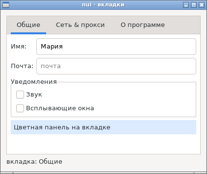
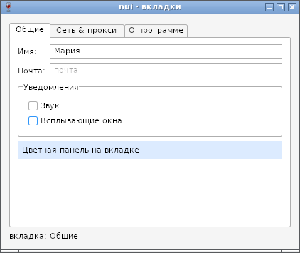
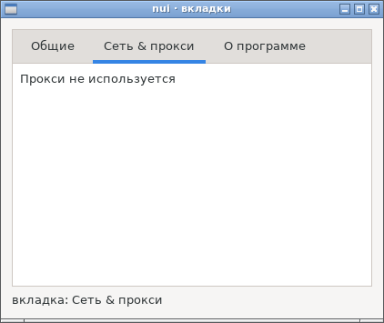
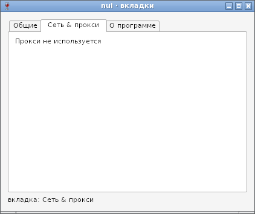

# Вкладки (Tabs) — отчёт

**Статус: готово (12.10.2026).** `nui.NewTabs()` — несколько страниц на одном месте, сверху ярлыки ([api.md](../api.md), §15): `Add`, `Remove`, `Len`, `Page`, `Current`, `SetCurrent`, `Title`, `SetTitle`, `OnChange`. Работает на GTK и Win32.

## Как устроено

| | GTK | Win32 |
|---|---|---|
| Виджет | `GtkNotebook` с прокруткой ярлыков | `SysTabControl32` над страницами в том же хосте, как рамка Frame; область страниц вырезана из его окна (`SetWindowRgn`) |
| Размер | GtkNotebook: самая большая видимая страница плюс ярлыки и рамка | вид `Stack` движка раскладки — то же правило; оформление — `TCM_ADJUSTRECT`, ширина не меньше самого широкого ярлыка со стрелками |
| Фон страницы | тема GTK | хост рисует область страниц цветом темы (`WM_PRINTCLIENT` временного контрола, точка в середине страницы); тот же цвет — у подписей и флажков на странице |
| `OnChange` | `switch-page`, только если прежняя страница была видна (GTK сам уходит со спрятанной и удалённой) | `TCN_SELCHANGE` — его шлёт только выбор пользователя |
| Клавиши | Ctrl+PgUp/PgDn — сам GtkNotebook | Ctrl+PgUp/PgDn и Ctrl+Tab — цикл сообщений nui |

Поведение снято с GTK тестом-замером и повторено на Win32:
- оформление GtkNotebook — 1, 38, 1, 1 точки;
- все страницы получают одно место, не текущие не показаны (`Size` — 0, 0);
- спрятали или убрали текущую — текущей становится следующая видимая, иначе предыдущая;
- пустые вкладки — 2×2, `Current` −1.

Размер программ без вкладок:
- **Linux.** Код вкладок в них не попадает. TinyGo-сборки: `hello` 24 744 байт (как было), `form` +16, `chat` −16, `viewer` −32 — сдвиг выравнивания.
- **Windows.** Go-код вкладок общий код узлов вызывает через хуки (`tabsHooks`), их задаёт `TabsNew`; без хуков `hello` (TinyGo) вырос бы на 4,6 КБ. Осталось +1,5 КБ у `hello` и +0,5 КБ у `form`: около 950 байт — C-обёртки вкладок, а TinyGo линкует C-код драйвера целиком, как уже у List, Canvas и Image (`-ffunction-sections` не помогает — проверено); остальное — ветки общего кода и Ctrl+Tab в цикле.

## Проверка

`TestTabs`, `TestTabsSizes` (GTK и Wine, обычная и отладочная сборка):
- размер по самой большой странице;
- `SetCurrent` без `OnChange`;
- щелчок по ярлыку и Ctrl+PgUp/PgDn с `OnChange`;
- скрытие и удаление текущей;
- заголовки, паники, контекстное меню страницы;
- пустые вкладки и длинный ярлык.

`TestTabsHitWindows` (только Windows): щелчок по полю на странице достаётся полю, хотя контрол вкладок лежит над ним, а щелчок по ярлыку — вкладкам. Проверяется через `WindowFromPoint`, который учитывает регион окна.

## Фотоотчёт

| | |
|---|---|
|  | **Linux (GTK3)**: поля в сетке, рамка с флажками и цветная панель на вкладке; `&` в заголовке — обычный символ |
|  | **Windows (Wine 8.0)**: фон области страниц — цвет темы, у подписей, внутри рамки и вокруг полей он тот же |
|  | GTK: переключение на вторую вкладку (`SetCurrent(1)` через 300 мс после показа) |
|  | Wine: то же; контролы первой страницы скрыты, область перерисована |

На настоящей Windows ещё не проверено.
