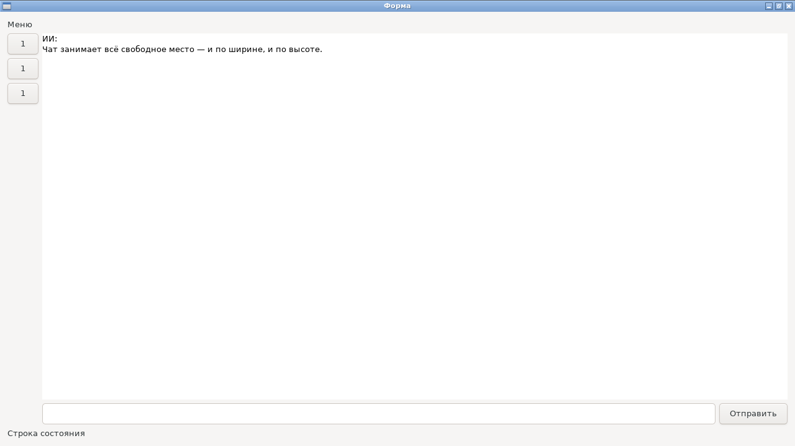
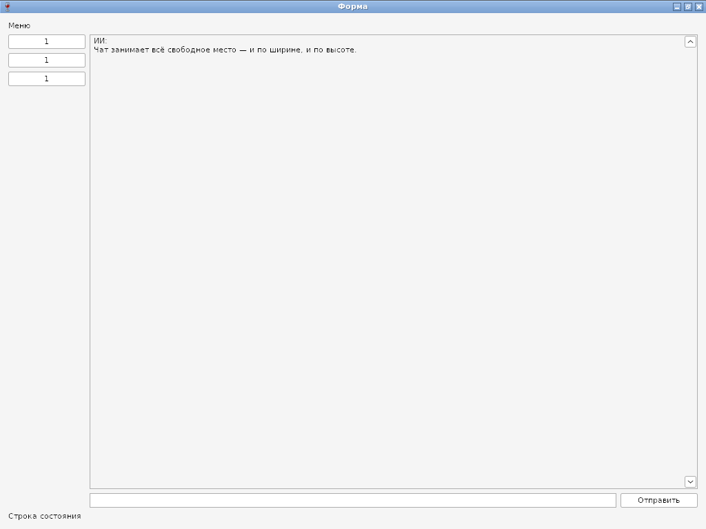

# Окно на весь экран: SetMaximized, SetFullscreen

**Статус: готово (09.10.2026).** Новые методы окна ([api.md](../api.md), §5):
- `SetMaximized(on)` — развернуть на весь экран, с рамкой и заголовком; `false` — восстановить;
- `SetFullscreen(on)` — полноэкранный режим без рамки, поверх панелей.

Оба можно вызывать до `Show`: окно сразу откроется развёрнутым или полноэкранным, а `SetSize` задаёт размер, к которому окно вернётся.

| ОС | Как |
|---|---|
| Linux | `gtk_window_maximize`/`fullscreen`. Разворачивает оконный менеджер (композитор): без него — например, в `make test` под Xvfb — просьба не действует |
| Windows | `ShowWindow(SW_MAXIMIZE)`; полноэкранный — стиль `WS_POPUP` без рамки и прямоугольник монитора окна, прежние стиль и место запоминаются |

## Частый вопрос: почему виджет не растягивается

Свободное место в ряду (`HBox`, `VBox`) получают только виджеты, помеченные `Expand` ([layout.md](../layout.md), §3). Поперёк ряда дети и так занимают всю ширину или высоту. Чтобы чат занял всё место справа от меню:

```go
workspace := nui.HBox(wsMenu, nui.Expand(chat))
w := nui.NewWindow("Форма", nui.VBox(menu, nui.Expand(workspace), statusBar))
w.SetMaximized(true)
w.Show()
```

## Фотоотчёт

Тот же код — окно развёрнуто (у заголовка кнопка «восстановить»), чат занимает всё свободное место.

| | |
|---|---|
|  | **Linux (GTK3)**, Xvfb 1280 × 720 с openbox |
|  | **Windows (Win32, Wine 8.0)**, 1024 × 768. Кнопки меню шире, чем на GTK: естественная ширина кнопки Windows — 75 DLU (driver-win32.md, §6) |
