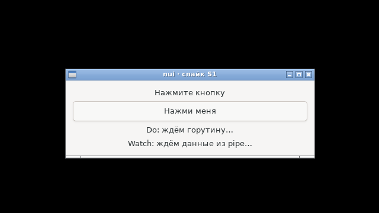
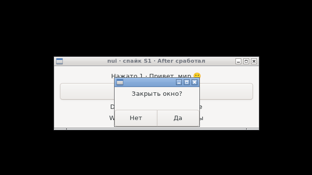

# S1 — итог: gc + cgo без системных заголовков + GTK3

**Статус: пройден.** ADR-3 (собственные прототипы вместо `<gtk/gtk.h>`) подтверждён.
Проверено 08.10.2026: чистый Debian 12 в Docker (`./run-bookworm.sh`) и хост Debian testing (`./check-protos.sh`).

## Критерии

| # | Проверка | Итог |
|---|---|---|
| 1 | Сборка без `libgtk-3-dev` | ✓ Debian 12, только `libgtk-3-0` 3.24.38, gcc 12, Go 1.26.5 |
| 2 | Линковка по soname | ✓ `NEEDED`: libgtk-3.so.0, libgobject-2.0.so.0, libglib-2.0.so.0, libc.so.6 |
| 3 | Сценарий из 5 пунктов | ✓ автопилот под Xvfb (`-auto`): клик, `Do` из горутины, `After`, `Watch` на pipe, крестик «Нет» / «Да». Вручную на X11/Wayland — **ещё не проверено** |
| 4 | Нет предупреждений GTK | ✓ `G_DEBUG=fatal-criticals`, вывод GTK пуст |
| 5 | Прототипы верны | ✓ `check-protos.sh` на GTK 3.24.52. Негативная проверка: ловит неверный тип параметра и результата, недостающий параметр, неверную константу, потерянный `const` |
| 6 | Размер, `-s -w` | **1 477 448 байт** → бюджет gc для hello: замер + 10 % ≈ 1 625 000 |
| 7 | Флаги C-части | через `CGO_CFLAGS`/`CGO_LDFLAGS` — экономия всего ~4 КБ под gc (1 481 840 → 1 477 448): C-часть крошечная, весит рантайм Go |
| 8 | Версия glibc | ✓ максимум `GLIBC_2.34` |

## Выводы

- Обработчики, `Do`, таймеры и `Watch` выполняются в главном потоке; вложенный цикл `gtk_dialog_run` не мешает таймерам.
- Кириллица и эмодзи проходят Go → GTK → Go без потерь (`cstr` / `gostr` без `C.GoString`).
- Подвох при проверке прототипов: если исходник идёт из stdin, `#include "x.h"` сначала ищется в текущем каталоге.
- Подвох Docker: в Debian-пакете Go `src` — симлинк в `/usr/share/go-*`, монтировать нужно оба каталога.
- **Подвох снимков: `xwd -root` врёт.** GTK 3 создаёт окна с визуалом, пригодным для OpenGL (`0x3b7`), а не с визуалом экрана по умолчанию (`0x21`). Видя несколько визуалов, `xwd` склеивает снимок по кусочкам и теряет перекрывающиеся окна: модальный диалог поверх родителя выходил чёрным. Сам диалог при этом рисовался: по журналу `xtrace` GTK кладёт картинку в окно (`CopyArea`), а снимок одним `XGetImage(root)` показывает его целиком. Ни nui, ни GTK, ни Xvfb не виноваты. Снимки теперь делает свой [`rootshot`](../../tools/rootshot.c) — он встроен в образ [`bookworm.Dockerfile`](../../tools/bookworm.Dockerfile).

## Фотоотчёт

Снимки делает сам сценарий (`-auto -shots shots`, сборка `-tags shots`) под Xvfb с openbox и `LANG=ru_RU.UTF-8`, инструментом `rootshot`.

| | |
|---|---|
|  | **1. Старт.** Окно с рамкой, метки ждут событий |
|  | **2. Клик** (через `gtk_button_clicked`): метка «Нажато 1 · Привет, мир 🙂» |
|  | **3. Через ~1 с:** `Do` из горутины, `Watch` прочитал pipe, `After` сменил заголовок |
|  | **4. Крестик → «Закрыть окно?»** Модальный диалог `Ask` из обработчика `delete-event`, кнопки «Нет» / «Да» на языке системы |
|  | **5. Ответ «Нет»:** окно осталось |

## Открыто

- Ручной прогон на настоящем рабочем столе (X11 и Wayland): `go build -o s1 . && ./s1`.
