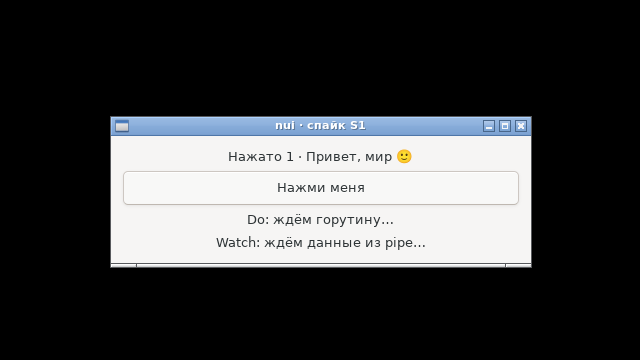
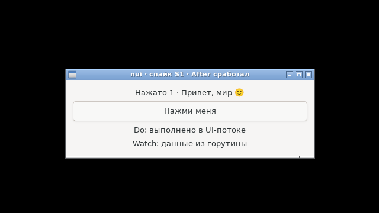

# S3 — итог: штатный TinyGo + свой target-файл вместо PR #5838

**Статус: пройден.** Спайк S1 собирается **выпущенным** TinyGo 0.42.0 против системной glibc и GTK3 и проходит все критерии S2. Ждать слияния [PR #5838](https://github.com/tinygo-org/tinygo/pull/5838) (`-libc=glibc`) не нужно: путь TinyGo для ADR-4 открыт.
Проверено 08.10.2026 в чистом Debian 12 (`./run-tinygo.sh`, образ `nui-bookworm`, без `libgtk-3-dev`).

## Как это устроено

[`linux-glibc-amd64.json`](linux-glibc-amd64.json) повторяет встроенную цель TinyGo для linux/amd64 (`compileopts/target.go`) с отличиями — ровно теми, что вносит PR #5838, только без патча:

| Поле | Встроенная цель | Наша цель | Зачем |
|---|---|---|---|
| `libc` | `musl` (своя, статическая) | `""` — не собирать | вторая libc в одном процессе с GTK несовместима (TLS) |
| `llvm-target` | `x86_64-unknown-linux-musleabihf` | `x86_64-unknown-linux-gnu` | ABI glibc |
| `cflags` | заголовки musl из TinyGo | `-isystem/usr/include/x86_64-linux-gnu`, `-isystem/usr/include` | C-файлам рантайма TinyGo (`runtime_unix.c`, `signal.c`, `task_threads.c`, …) нужны заголовки libc; берутся из `libc6-dev` |
| `ldflags` | `--gc-sections` | + `--dynamic-linker=/lib64/ld-linux-x86-64.so.2`, `-L/usr/lib/x86_64-linux-gnu`, `crt1.o`, `crti.o`, `crtn.o`, `-lc` | динамическая линковка с системной glibc встроенным `ld.lld` |
| `gc` | `boehm` | `conservative` | маленький сборщик из size.md; на сценарии хватает |

Самому nui заголовки libc не нужны вообще: `s1.h` объявляет всё сам (ADR-3).

## Критерии S2

| # | Проверка | Итог |
|---|---|---|
| 1 | Сборка и линковка | ✓ штатный `tinygo build -target=linux-glibc-amd64.json`; `NEEDED`: libc.so.6, libgtk-3.so.0, libgobject-2.0.so.0, libglib-2.0.so.0; интерпретатор `/lib64/ld-linux-x86-64.so.2` |
| 2 | `.c`-файл пакета (`wrap.c`) | ✓ `nui_connect` и др. работают — сценарий проходит |
| 3 | `//export`-трамплины из C | ✓ клик, таймеры, `Watch`, `delete-event` с ответом |
| 4 | Строки через память Go | ✓ кириллица и эмодзи туда и обратно |
| 5 | Главный поток | ✓ `gettid() == getpid()` в обработчиках |
| 6 | Сборщик мусора не ломает реестр | ✓ 60 с: 5645 шагов по 64 КБ (≈ 350 МБ мусора) + одноразовый таймер на каждом шаге; клик после этого работает; RSS 75,5 → 76,5 МБ. **10 минут (как в roadmap): 56 496 шагов, ≈ 3,5 ГБ мусора, RSS 75,8 → 76,6 МБ — утечек нет, клик работает** |
| 7 | `-scheduler=threads`: `Do` из горутины | ✓ |
| 8 | Размер `-scheduler=none` ≤ 64 КБ | ✓ **35 952 байта** после `strip` (56 640 до) |

Оба варианта (`threads` и `none`) прошли сценарий с `G_DEBUG=fatal-criticals`. В варианте `none` горутин нет: `Do` и запись в pipe идут из таймеров ([`background_none.go`](../s1/background_none.go)).

## Размер: один и тот же исходник

| Сборка | Байт | После `strip` |
|---|---|---|
| gc, `-trimpath -ldflags="-s -w"` | 1 572 520 | — |
| TinyGo `threads`, `-opt=z -no-debug -panic=trap` | 63 272 | 40 096 |
| TinyGo `none`, `-opt=z -no-debug -panic=trap` | 56 640 | **35 952** |

TinyGo без планировщика — в **44 раза** меньше gc. `strip` обязателен: `-no-debug` оставляет таблицу символов (−20 КБ).

## Подвохи

- **Штатный TinyGo с musl не линкуется** с GTK: `ld.lld: unable to find library -l:libgtk-3.so.0` (нет системных путей), а с путями получились бы две libc в одном процессе.
- **`"linker": "cc"` TinyGo 0.42 не принимает** («linker cc should be ld.lld»), поэтому glibc подключается вручную, как в PR: `crt1.o`, `crti.o`, `crtn.o`, `-lc`, `--dynamic-linker`.
- `crtn.o` стоит не последним (флаги цели идут до объектов). Это безопасно, пока ни один объект не добавляет секцию `.init` — у Go-кода TinyGo и наших обёрток её нет. Если появится C с конструкторами старого типа, `crtn.o` надо перенести в конец.
- **Повторяющиеся значения в списках target-файла запрещены**: `"-isystem", "a", "-isystem", "b"` — ошибка; писать `-isystem/a`.
- В TinyGo 0.42 на Linux по умолчанию `gc=boehm` и `scheduler=threads`. Наша цель задаёт `conservative`; флаги `-gc` и `-scheduler` в командной строке её перекрывают.
- Проверен только amd64. Для arm64 нужен свой файл: `/usr/lib/aarch64-linux-gnu`, загрузчик `/lib/ld-linux-aarch64.so.1`, `cpu`/`features` aarch64.

## Фотоотчёт (сборка TinyGo, `threads`)

Снимки делает сам сценарий (`-tags shots`, снимок через `system("rootshot | pnmtopng …")` из libc — `os/exec` в TinyGo не нужен) под Xvfb с openbox и `LANG=ru_RU.UTF-8`.

| | |
|---|---|
|  | **1. Старт.** Бинарник TinyGo, glibc, системный GTK3 |
|  | **2. Клик:** «Нажато 1 · Привет, мир 🙂» — строки Go → C → Go без потерь |
|  | **3. Через ~1 с:** `Do` из горутины (планировщик `threads`), `Watch` прочитал pipe, `After` сменил заголовок |
|  | **4. Крестик → «Закрыть окно?»** — модальный диалог из `delete-event` |
|  | **5. Ответ «Нет»:** окно осталось |

## Открыто

- arm64: отдельный target-файл и прогон (Raspberry Pi OS / Debian arm64).
- Ручной прогон на настоящем рабочем столе.
