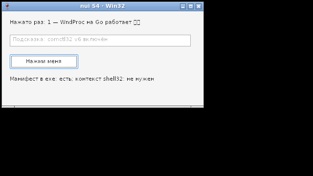

# Спайк S4: hello на Win32 под gc и TinyGo — результат

**Итог: пройден (09.10.2026).** Оба тулчейна собирают Win32-программу на Debian 12 кросс-компиляцией (mingw-w64). Под Wine 8.0 в Xvfb она открывает окно, нажатие кнопки приходит в WndProc на Go, программа выходит с кодом 0. Настоящая Windows 10/11 остаётся ручной проверкой (driver-win32.md, §11; roadmap, фаза 5).

Запуск: `NUI_IMAGE=nui-win tools/docker-run.sh sh spike/s4/run.sh`. Образ `nui-win` (`tools/win.Dockerfile`): Debian 12, `gcc-mingw-w64-x86-64`, Wine 8.0, Xvfb, openbox, rootshot. Полный журнал пишется в `out/report.txt`.

## Что проверено

| Пункт (driver-win32.md, §1, §11) | gc | TinyGo 0.42 |
|---|---|---|
| cgo без заголовков: свои прототипы `win32.h` | ✓ (mingw gcc) | ✓ (clang TinyGo) |
| Прототипы против `<windows.h>` mingw-w64 (`NUI_CHECK`, тот же приём, что у GTK) | ✓ | — |
| WndProc — трамплин `//export nuiWndProc`, указатель на него ставит C-обёртка | ✓ | ✓ |
| Таймер (`WM_TIMER`), `BM_CLICK` → `WM_COMMAND` → обработчик на Go, `WM_DESTROY` → `PostQuitMessage` → выход с кодом 0 | ✓ | ✓ |
| Манифест (Common Controls v6, PerMonitorV2) из ресурсов | ✓ `.syso` подхватывается сам | ✓ тот же объект через `#cgo LDFLAGS: -L. -l:rsrc.o` (см. ниже) |
| Подсистема GUI (без консоли) | ✓ `-ldflags -H windowsgui` | ✓ после линковки: `objcopy --subsystem windows` |
| Размер | 1 365 504 байта | **46 080 байт** |

Что comctl32 v6 действительно включилась, видно по подсказке в пустом поле (`EM_SETCUEBANNER` есть только у v6) и по виду кнопки.

## Находки

1. **TinyGo не подхватывает `.syso`.** Тот же объект `windres` (`rsrc.o`) уходит линковщику из файла с тегом `tinygo` (`rsrc_tinygo.go`): `#cgo LDFLAGS: -L. -l:rsrc.o`.
   - `${SRCDIR}` TinyGo не раскрывает (`-L${SRCDIR}` превратился в `-L<каталог пакета>/${SRCDIR}`), а путь к файлу в LDFLAGS отвергает как «invalid flag».
   - Относительный `-L` TinyGo сам отсчитывает от каталога пакета, а `-l:файл` lld подключает целиком — ресурсу не нужны символы, чтобы попасть в exe.
2. **Подсистема GUI в TinyGo — только после линковки.** `-Wl,--subsystem,windows` проходит проверку флагов TinyGo, но ld.lld получает его как есть и не понимает. Поэтому `x86_64-w64-mingw32-objcopy --subsystem windows --strip-all`: заодно убирается таблица символов COFF, которую `-no-debug` оставляет (65 024 → 46 080 байт).
3. **Библиотеки импорта.** TinyGo несёт только kernel32, advapi32 и UCRT. `user32` и `gdi32` берутся из mingw-w64: `-L/usr/x86_64-w64-mingw32/lib`. TinyGo-сборке нужен UCRT (`api-ms-win-crt-*`), он есть в Windows 10+. gc берёт `msvcrt.dll`.
4. **comctl32 нельзя импортировать статически.** Статический импорт загружает её при старте, и если манифеста нет, это v5. Обёртка грузит comctl32 через `LoadLibraryW` и вызывает `InitCommonControlsEx` через `GetProcAddress`. Так же устроен поиск `TaskDialog` в ADR-16: с манифестом подгружается v6, а у exe нет зависимости от comctl32 вообще.
5. **Запасной путь без манифеста под Wine не работает.** Контекст активации из ресурса 124 `shell32.dll` создаётся и становится контекстом процесса (`CreateActCtxW` и `ActivateActCtx` успешны), но EDIT остаётся v5, подсказки нет (снимок `s4-nomanifest`). Работает ли приём на настоящей Windows — ручная проверка. Основной путь — манифест в exe, и он работает в обоих тулчейнах.
6. **Wine 8.0 из Debian 12 не запускает программы на Go ≥ 1.22:** рантайм берёт `ProcessPrng` из `bcryptprimitives.dll`, а в Wine 8.0 её нет. На Windows 10+ она системная. Только для запуска под Wine `run.sh` кладёт в префикс заглушку на два десятка строк (`wine/bcryptprimitives.c`: `ProcessPrng` → `RtlGenRandom`). В exe и в nui она не попадает.
7. **Планировщики TinyGo под Windows.** Собирается только планировщик по умолчанию (`tasks` + сборщик `boehm`). `-scheduler=none` (`undefined symbol: tinygo_task_exit`) и `-scheduler=threads` (`undefined: threadID`) в 0.42 под Windows не линкуются. С `tasks` горутины кооперативные в одном потоке: пока главная горутина ждёт в `GetMessageW`, другие не выполняются. Значит, на Windows программам с горутинами (рабочий поток + `Do`) нужна сборка gc, а TinyGo — для программ без горутин, как `-scheduler=none` на Linux.
8. **Заголовки окон не в ASCII** `xwininfo` в локали C не печатает («failure in conversion from UTF8_STRING»), поэтому `run.sh` ищет окно Wine по классу (имени exe).

## Фотоотчёт

Снимки сделаны под Wine 8.0 в Xvfb с openbox. Программа сама нажимает кнопку через 0,5 с (`BM_CLICK`), снимок — через 1,5 с, окно закрывается через 4 с. Эмодзи в подписи Wine рисует квадратиками: у него нет цветного шрифта. На Windows это Segoe UI Emoji.

| | |
|---|---|
|  | **gc, манифест из `.syso`.** Подпись сменилась после нажатия — WndProc на Go работает. В поле подсказка: comctl32 v6 включена. Кнопка по умолчанию в стиле v6 |
|  | **TinyGo, 46 КБ.** То же самое: манифест прилинкован через `-l:rsrc.o`, comctl32 v6 включена |
|  | **gc без манифеста — для сравнения.** comctl32 v5: подсказки нет, кнопка в классическом стиле. Контекст из `shell32.dll` под Wine создаётся, но v6 не включает (находка 5) |

## Что это значит для драйвера

- FFI тот же, что на Linux: свои прототипы (`win32_windows.h`) со сверкой против mingw-w64 и трамплин `//export`.
- Пример (приложение) несёт `app.rc`: `.syso` для gc и тот же объект через `-l:` для TinyGo. nui даёт шаблон манифеста.
- `make` для TinyGo под Windows: `objcopy --subsystem windows --strip-all` после сборки.
- comctl32 (`InitCommonControlsEx`, `TaskDialog`) — только через `LoadLibraryW` + `GetProcAddress`.
